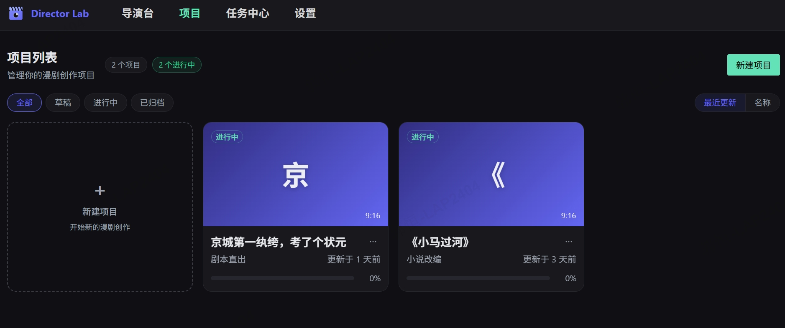
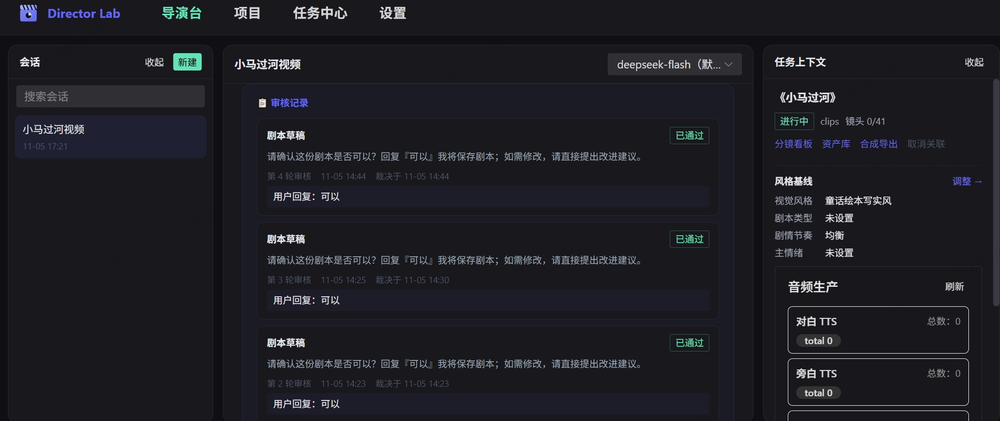
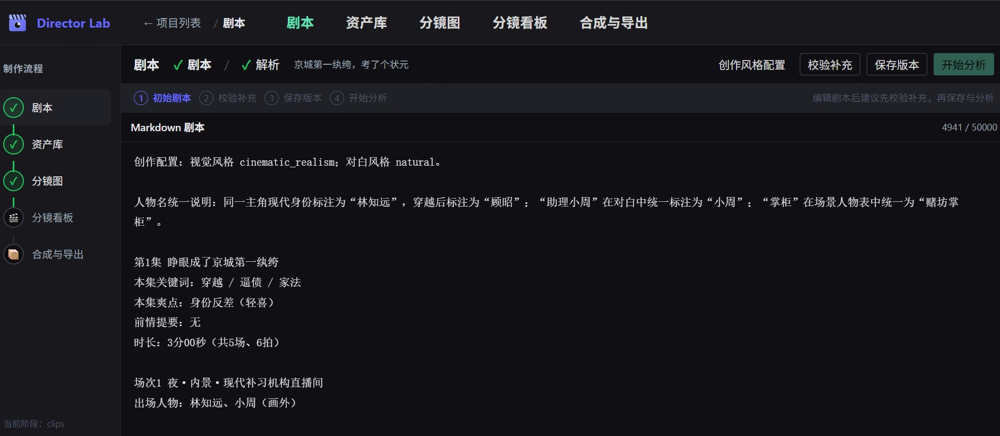
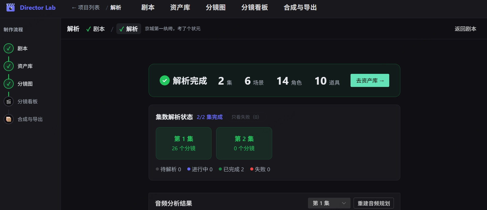
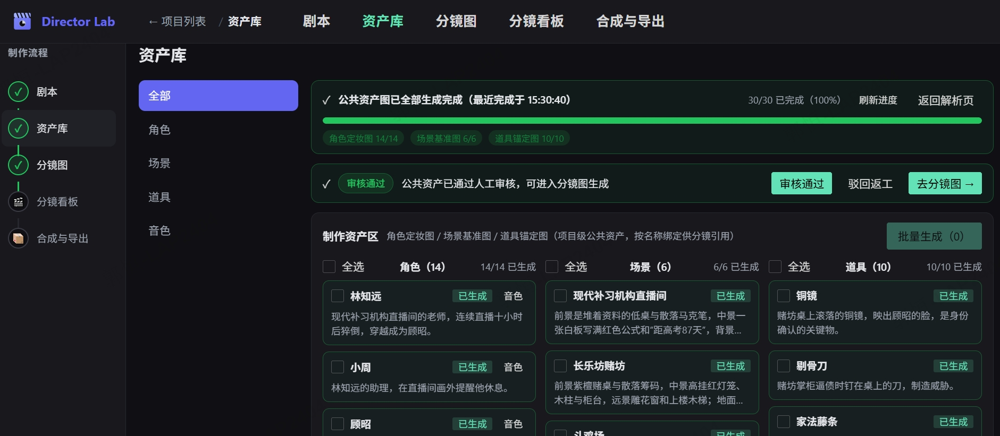
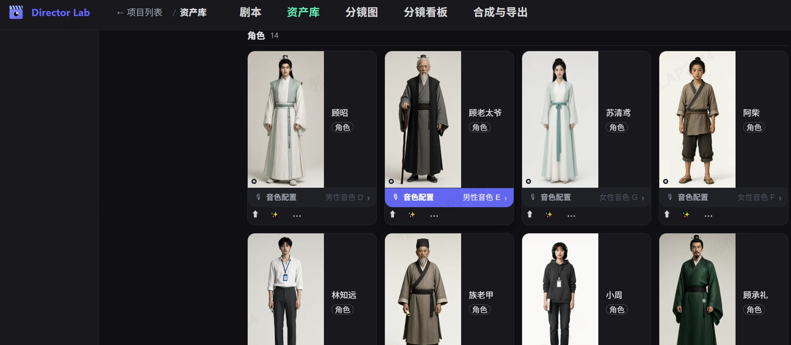
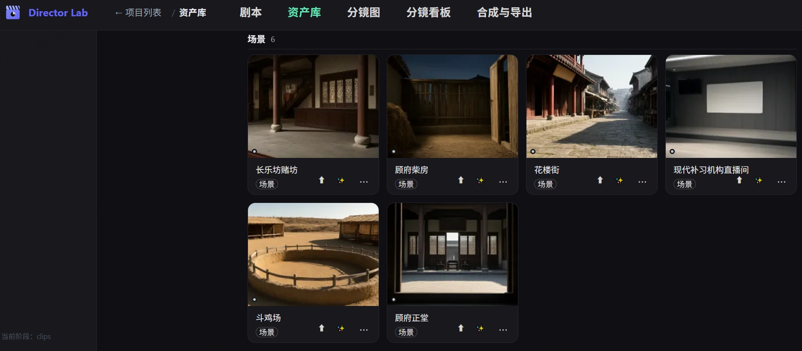
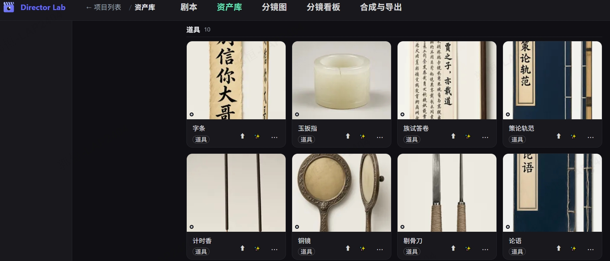
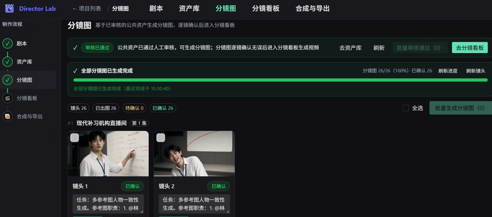
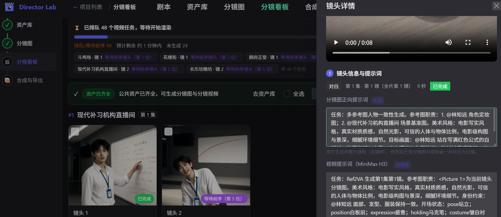

# director-lab

自托管漫剧生产工作台：FastAPI + SQLite + Vue 3 前端，以本地 ComfyUI 为渲染底座。


## 项目简介

基于 ComfyUI 的 AI 漫剧生产工作台。

完全免费 · 本地化部署：所有算力来自自建 ComfyUI 实例，无需云端 API，零持续费用。支持多台闲置 GPU 机器组池，配合内网穿透即可扩展。

三层负载均衡：实例健康熔断（心跳探测 + 自动摘除恢复）→ 实时负载调度（least-connections 按队列深度派发）→ 任务级故障转移（提交失败自动换实例重试），三重保障高可用。

从剧本到成片的完整链路：

```text
剧本创作/评估 → 剧本解析 → 资产计划 → 分镜图生成 → 视频串行生成 → 语音/音频合成 → 成片导出
```

## 项目页面

<table>
  <tr>
    <td width="50%" align="center"><br><sub>项目列表：管理多个漫剧项目，支持草稿 / 进行中 / 已归档筛选</sub></td>
    <td width="50%" align="center"><br><sub>导演台：内置 AI 助手会话、审批记录与任务上下文</sub></td>
  </tr>
  <tr>
    <td width="50%" align="center"><br><sub>剧本编辑：Markdown 剧本、创作配置与分步流程（补充 → 保存 → 分析）</sub></td>
    <td width="50%" align="center"><br><sub>剧本解析：自动拆分集数 / 场景 / 角色 / 道具，并统计解析状态</sub></td>
  </tr>
  <tr>
    <td width="50%" align="center"><br><sub>资产库：角色、场景、道具、音色的统一管理与生成进度</sub></td>
    <td width="50%" align="center"><br><sub>角色资产：角色定妆图与音色配置，支持重新生成与批量操作</sub></td>
  </tr>
  <tr>
    <td width="50%" align="center"><br><sub>场景资产：场景基准图按名称绑定，供分镜与视频生成引用</sub></td>
    <td width="50%" align="center"><br><sub>道具资产：道具锚定图，维护跨镜头的外观一致性</sub></td>
  </tr>
  <tr>
    <td width="50%" align="center"><br><sub>分镜图：基于已审核公共资产批量生成，确认后进入分镜看板</sub></td>
    <td width="50%" align="center"><br><sub>分镜看板：镜头详情、参考图职责与 MiniMax H3 视频生成任务</sub></td>
  </tr>
</table>

## 核心功能

| 模块 | 能力 |
| --- | --- |
| 剧本创作与评估 | AI 编剧（script_writing / script_evaluation），剧本解析、场景切分、意图路由与风格配置 |
| 分镜与资产管理 | 分镜看板、资产计划（asset_plan）、角色/道具绑定与生命周期校验、参考图注入（ref_inject / shot_refs） |
| 视频串行链式生成 | 按镜头序号串行执行（chained 模式），前镜尾帧自动提取并绑定为本镜首帧引用（shot_chain）；全链路进度事件可观测，尾帧绑定失败自动级联取消防止缺参数生成 |
| 音频管线 | 语音库匹配（voice_matching）、音频计划与片段状态管理、compose 时长对齐合成 |
| 一致性控制 | 跨集连续性记录、首帧使用追踪、图像质量门控（image_quality）、验收检查（acceptance_check） |
| 重新生成工作台 | 按资产/镜头维度的重生成编排，版本号递增不覆盖历史 |
| Agent 治理 | 内置 AI 助手，带审批门控、会话记忆与治理约束 |
| 任务调度 | worker 调度器统一编排生成/合成/导出/解析执行器，支持重试熔断与对账续跑 |

## 项目结构

- `backend/`：FastAPI 后端（SQLAlchemy 2.0 + Alembic + Pydantic v2）
  - `app/api/v1/`：REST 接口层（projects / script / shots / generate / audio / compose / voice_matching / agent 等）
  - `app/services/`：业务服务层（剧本、分镜链、资产计划、语音匹配、一致性、Agent 等 60+ 模块）
  - `app/worker/`：后台调度器与任务执行器
  - `app/integrations/`：ComfyUI 客户端与实例池（comfyui_pool，含负载均衡与健康熔断）
- `frontend/`：Vue 3 + TypeScript + Vite + Naive UI + Pinia + TanStack Query
- `docs/`：架构与规范文档（ARCHITECTURE / API / DATABASE / WORKFLOW 等），`docs/IMPLEMENTATION_PLAN.md` 为开发实施计划
- `docs/img/`：项目页面截图
- `docs/model/`：ComfyUI 与模型一键部署脚本

## 环境要求

- Python ≥ 3.11，Node.js ≥ 20，ffmpeg ≥ 6.0
- 渲染底座：NVIDIA GPU + 可用的 CUDA 环境（运行 ComfyUI）
- 磁盘：ComfyUI 依赖 + H3/Qwen 模型约 66 GiB，另加 TTS 与输出文件，建议预留 **80 GB 以上**

## ComfyUI 渲染底座部署

`docs/model/` 下提供两个一键部署脚本，自动完成环境检查、克隆并安装 ComfyUI、下载模型、校验文件、启动服务：

| 脚本 | 适用场景 | 默认端口 |
| --- | --- | --- |
| [`autodl_comfyui_qwen21_h3_setup.py`](docs/model/autodl_comfyui_qwen21_h3_setup.py) | AutoDL 等 GPU 容器；自动识别数据盘、复用镜像自带 ComfyUI | AutoDL 为 `6006`，其他平台 `8188` |
| [`cloudstudio_comfyui_qwen21_h3_setup.py`](docs/model/cloudstudio_comfyui_qwen21_h3_setup.py) | CloudStudio / 通用 Linux / Notebook 环境 | `8188` |

脚本特性：

- 模型按仓库内路径直接落到 `ComfyUI/models/`，下载后无需手动搬运
- 国内网络自动切换 pip 清华源与 HuggingFace `hf-mirror`，可优先走 ModelScope
- AutoDL 自动把 `models` 目录软链到数据盘，并在端口已有 ComfyUI 时直接复用
- 自动安装 Qwen3-TTS 自定义节点；缺节点时工作流会因 `missing_node_type` 被 400 拒绝
- 支持 cloudflared / pinggy / localhost.run 公网隧道，方便跨机加入实例池

### 一键启动

```bash
cd docs/model

# 查看下载计划（不落盘）
python autodl_comfyui_qwen21_h3_setup.py plan

# 检查环境 + 安装 ComfyUI + 下载模型 + 校验 + 启动（推荐）
python autodl_comfyui_qwen21_h3_setup.py all --groups h3 qwen tts --port 8188

# 分步执行
python autodl_comfyui_qwen21_h3_setup.py download --groups h3 qwen tts
python autodl_comfyui_qwen21_h3_setup.py verify   --groups h3 qwen tts
python autodl_comfyui_qwen21_h3_setup.py launch   --port 8188
python autodl_comfyui_qwen21_h3_setup.py status
python autodl_comfyui_qwen21_h3_setup.py log --lines 80
python autodl_comfyui_qwen21_h3_setup.py stop
```

在 Notebook 中也可以按函数调用：

```python
import autodl_comfyui_qwen21_h3_setup as cs

cs.print_plan(["h3", "qwen", "tts"])
cs.check_env()
cs.ensure_comfyui()
cs.install_requirements()
cs.ensure_qwen3_tts_node()          # 安装 Qwen3-TTS 自定义节点
cs.download_models(["h3", "qwen", "tts"])
cs.verify_models(["h3", "qwen", "tts"])
cs.launch(wait=True)
```

### 模型清单

以下为默认必备模型（来源：`Comfy-Org/MiniMax-H3`、`Comfy-Org/Qwen-Image-2.1`、`Qwen/Qwen3-TTS-12Hz-1.7B-CustomVoice`，大小为十进制近似值）：

| 组 | 模型文件（相对 `ComfyUI/models/`） | 说明 | 大小 |
| --- | --- | --- | --- |
| `h3` | `diffusion_models/minimax_h3_ref2va_pruned_int8_convrot.safetensors` | H3 Ref2VA 扩散模型 INT8（pruned） | ≈ 20.97 GB |
| `h3` | `text_encoders/qwen3vl_32b_minimax_h3_int8_convrot.safetensors` | Qwen3-VL-32B 文本编码器 INT8 | ≈ 27.14 GB |
| `h3` | `vae/minimax_h3_video_vae_fp16.safetensors` | H3 视频 VAE FP16 | ≈ 5.21 GB |
| `h3` | `vae/minimax_h3_audio_vae_fp32.safetensors` | H3 音频 VAE FP32 | ≈ 0.61 GB |
| `qwen` | `diffusion_models/qwen_image_2.1_turbo_int8_convrot.safetensors` | Qwen-Image-2.1 Turbo 扩散模型 INT8 | ≈ 7.26 GB |
| `qwen` | `text_encoders/qwen3vl_8b_int8_convrot.safetensors` | Qwen3-VL-8B 文本编码器 INT8 | ≈ 9.35 GB |
| `qwen` | `vae/qwen_image_2.1_vae_bf16.safetensors` | Qwen-Image-2.1 VAE BF16 | ≈ 0.68 GB |
| `tts` | `Qwen3-TTS/Qwen3-TTS-12Hz-1.7B-CustomVoice/` | Qwen3-TTS 1.7B CustomVoice 整仓 | ≈ 3.5 GB+ |

可选扩展组（默认不下载，按需显式指定）：

| 组 | 模型文件 | 说明 | 大小 |
| --- | --- | --- | --- |
| `h3speed` | `vae/minimax_h3_video_vae_int8_convrot.safetensors` | H3 视频 VAE INT8，解码更快、显存更小 | ≈ 2.81 GB |
| `h3speed` | `loras/minimax_h3_ref2v_turbo_4step_v0.1_comfyui_bf16.safetensors` | H3 Ref2V 4 步 Turbo LoRA（20 步 → 4 步） | ≈ 1.96 GB |
| `h3vram` | `text_encoders/qwen3vl_32b_minimax_h3_nvfp4_awq.safetensors` | 32B 文本编码器 NVFP4 版，显著降低显存占用 | ≈ 15.69 GB |

```bash
# 出片提速：int8 VAE + 4 步 Turbo LoRA
python autodl_comfyui_qwen21_h3_setup.py download --groups h3speed

# 显存吃紧：换成 nvfp4 文本编码器
python autodl_comfyui_qwen21_h3_setup.py download --groups h3vram
```

> `cloudstudio_comfyui_qwen21_h3_setup.py` 的 `h3` 组默认包含 int8 视频 VAE 与 4 步 LoRA，与 AutoDL 版的组合略有差异，实际清单以脚本内 `MODELS` 定义为准。

### 启动参数

脚本最终以如下命令拉起 ComfyUI（日志写入工作目录下的 `comfyui.log`）：

```bash
python main.py --listen 0.0.0.0 --port 8188 --disable-auto-launch
# 可选：--preview-method auto --use-sage-attention --enable-cors-header
```

常用环境变量：

| 变量 | 作用 | 默认值 |
| --- | --- | --- |
| `COMFY_WORK_DIR` | 工作目录（ComfyUI 代码与日志） | 自动挑选磁盘空间最大的目录 |
| `COMFY_PORT` | ComfyUI 监听端口 | AutoDL `6006`，其他 `8188` |
| `COMFY_MODELS_DIR` | 模型目录 | `<ComfyUI>/models` |
| `COMFY_DOWNLOADER` | 下载器：`auto` / `hf` / `modelscope` | `auto` |
| `HF_MIRROR` | HuggingFace 镜像地址 | `https://hf-mirror.com` |
| `COMFY_TUNNEL` | 公网隧道：`none` / `cloudflared` / `pinggy` | 非 Notebook 平台为 `none` |
| `COMFY_SAGE` | 是否启用 SageAttention | `auto` |

### 接入 director-lab

ComfyUI 启动后，把地址写入后端环境变量或运行时配置即可：

```bash
# backend/.env
DLAB_COMFYUI_BASE_URL=http://127.0.0.1:8188
```

也可在应用内运行时配置 `backend/data/runtime_settings.json` 中动态增删实例地址、切换实例并清理连接缓存，无需重启服务。

## 启动方式（开发）

后端：

```bash
cd backend
python3 -m venv .venv && .venv/bin/pip install -e '.[dev]'
.venv/bin/alembic upgrade head
.venv/bin/uvicorn app.main:app --host 127.0.0.1 --port 8000
```

> Windows 下将 `.venv/bin/` 替换为 `.venv\Scripts\`。

前端：

```bash
cd frontend
npm install
npm run dev
```

开发服务器默认 5173 端口，`/api` 请求代理到 `127.0.0.1:8000`。

## 配置

所有可配置项集中在 [`backend/app/core/config.py`](backend/app/core/config.py)，以 `DLAB_` 前缀环境变量覆盖（ComfyUI 地址、一致性双阈值、H3 参数、时长上限等）。

ComfyUI 实例池支持运行时配置（`backend/data/runtime_settings.json`），可动态增删实例地址、切换实例并自动清理连接缓存，无需重启服务。

### ComfyUI 实例池

- 实例地址在应用内运行时配置（`backend/data/runtime_settings.json`），可动态增删实例、切换实例并自动清理连接缓存，无需重启服务。
- 多台闲置 GPU 机器组池：每台机器运行 ComfyUI 服务，通过内网穿透（如 CloudStudio 代理域名）暴露地址后加入实例池即可扩展算力。
- 调度策略：实例健康熔断 → least-connections 负载派发 → 任务级故障转移，单实例宕机不影响整体生成。

## 测试

```bash
cd backend && .venv/bin/python -m pytest tests/ -v
cd frontend && npm run build
```

## 文档

| 文档 | 内容 |
| --- | --- |
| [ARCHITECTURE.md](docs/ARCHITECTURE.md) | 状态机、任务队列、部署与备份 |
| [API.md](docs/API.md) | HTTP 接口定义 |
| [DATABASE.md](docs/DATABASE.md) | 表结构与数据字段 |
| [WORKFLOW.md](docs/WORKFLOW.md) | 工作流上传、校验、注入与 H3 生成 |
| [PROMPTS.md](docs/PROMPTS.md) | 剧本解析与分镜设计的 LLM 层规则 |
| [FRONTEND.md](docs/FRONTEND.md) | 前端页面、样式与交互 |
| [DEVELOPMENT.md](docs/DEVELOPMENT.md) | 环境搭建、启动、测试与部署 |
| [IMPLEMENTATION_PLAN.md](docs/IMPLEMENTATION_PLAN.md) | 开发实施计划与进度 |
