<div align="center">

<h1>Director-Lab</h1>

<p><strong>从一句剧本到一部短剧：AI Agent 驱动的自托管漫剧生产工作台</strong></p>

<p>剧本 · 角色 · 场景 · 道具 · 分镜 · 视频 · 配音 · 成片，在同一个工作台里完成</p>

<p>


</p>

<a href="https://github.com/user-attachments/assets/0838916c-3ce9-4791-80ba-39aefc2b0119">
  
</a>

<sub>示例项目《游乐场》成片 · 点击封面在线播放 2:12 完整成片 · 26 个镜头自动串联</sub>

</div>

---

## 这是什么

Director-Lab 是一个**自托管、可落地的 AI 漫剧 / 短剧生产系统**。

它不是一个“输入一句话，等一个视频”的黑盒生成器，而是把短剧生产中真正繁琐、重复、需要保持一致性的环节拆开，做成一条可审核、可回滚、可续跑的生产流水线：

- 剧本不只被“发送给模型”，而是被解析成**剧集、场景、角色、道具、对白和分镜**；
- 角色、场景、道具会先生成**可复用的参考资产**，再被分镜和视频反复引用，保证跨镜头一致性；
- 分镜图、视频、配音都是**独立可重生成**的版本化产物，不满意可以只重做某一个镜头；
- 视频按镜头串行生成，上一镜的尾帧会自动成为下一镜的首帧参考；
- 最终由 FFmpeg 完成字幕、音轨、时长对齐和成片导出。

所有渲染都来自你自己部署的 **ComfyUI**，不需要云端视频 API，也没有按秒计费。

> 当前仓库中的示例项目《游乐场》已完成从剧本解析到成片导出的完整链路：**11/11 公共资产、26/26 分镜图、26 个视频镜头、2:17 成片**。本 README 中的界面与作品均来自该示例项目。

<div align="center">
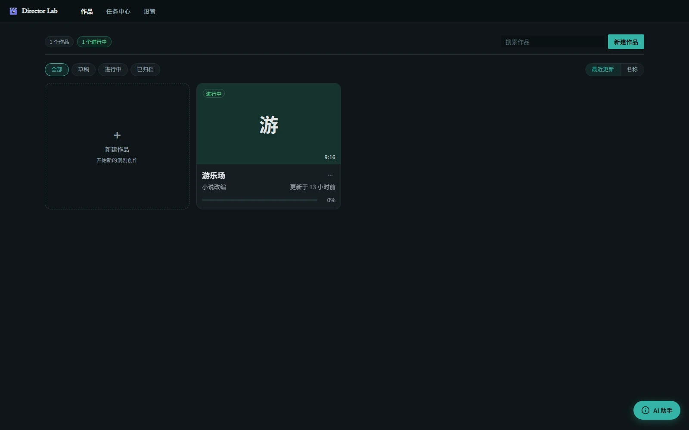
<sub>作品列表：多作品管理、草稿 / 进行中 / 已归档筛选、最近更新排序</sub>
</div>

## 它解决了什么问题

传统 AI 视频创作往往要在多个工具之间来回切换：

| 传统做法 | 在 Director-Lab 中 |
| --- | --- |
| 手工整理剧本、拆场景、记人物设定 | 剧本解析自动产出分集 / 场景 / 角色 / 道具 / 对白 |
| 每个镜头重新描述角色长相 | 角色定妆图作为公共资产，多参考图绑定到每个镜头 |
| 手工挑参考图、写图片提示词 | 分镜规划自动生成镜头提示词与参考图职责 |
| 逐条复制提示词到视频工具 | 分镜看板一键提交，按镜头序号串行生成 |
| 上一镜和下一镜人物、场景接不上 | 尾帧自动提取并绑定为下一镜首帧 |
| 配音、BGM、字幕、拼接各做一遍 | 音频规划 + TTS + FFmpeg 合成统一处理 |
| 生成失败从头再来 | 任务队列、重试熔断、版本化重生成、断点续跑 |

Director-Lab 的目标不是替代导演，而是把导演从**重复劳动和一致性维护**中解放出来，让创作者把时间花在判断和审美上。

## 核心能力

<table>
<tr>
<td width="50%">

<h3>01 剧本工作台</h3>
<p>Markdown 剧本编辑、创作配置、剧本评估与分步流程。支持小说改编、原创剧本和系列续写入口。</p>
<p><code>已实现</code></p>

</td>
<td width="50%">

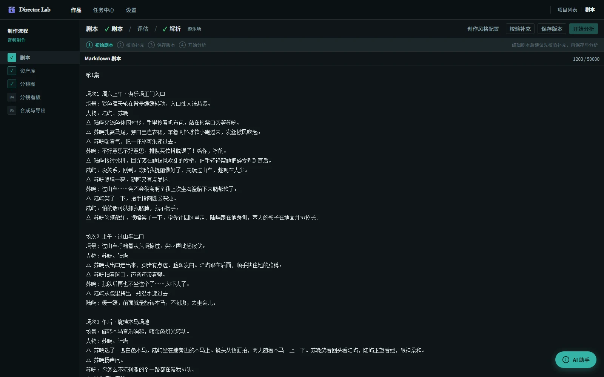

</td>
</tr>
<tr>
<td width="50%">

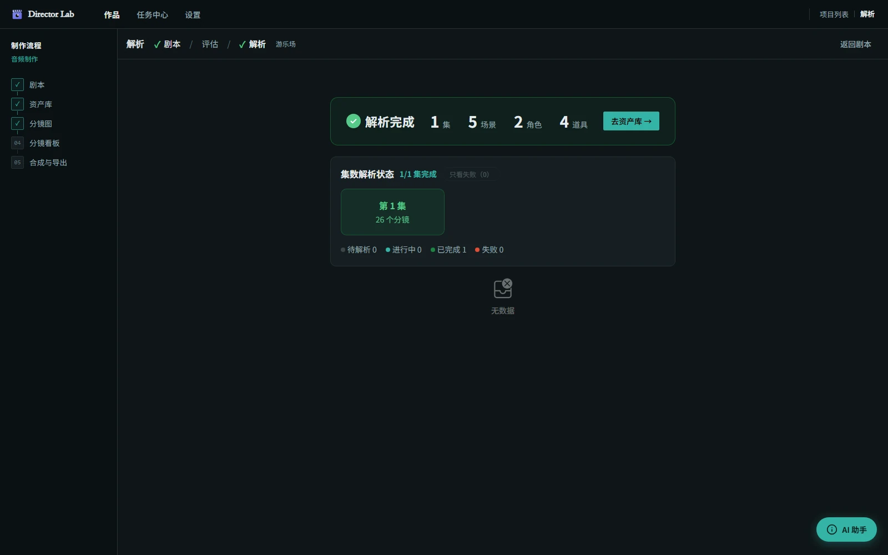

</td>
<td width="50%">

<h3>02 剧本解析与音频规划</h3>
<p>一次解析自动拆分集数、场景、角色、道具、分镜和对白；示例项目解析出 1 集、5 场景、2 角色、4 道具、26 个分镜。</p>
<p>同时生成对白 / 旁白 / BGM / SFX / 环境声的音频规划。</p>
<p><code>已实现</code></p>

</td>
</tr>
<tr>
<td width="50%">

<h3>03 角色 / 场景 / 道具资产库</h3>
<p>角色定妆图、场景基准图、道具锚定图统一管理，支持审核、重新生成、批量生成和跨镜头复用。</p>
<p>示例项目：2 个角色、5 个场景、4 个道具全部完成并通过审核。</p>
<p><code>已实现</code></p>

</td>
<td width="50%">


</td>
</tr>
<tr>
<td width="50%">

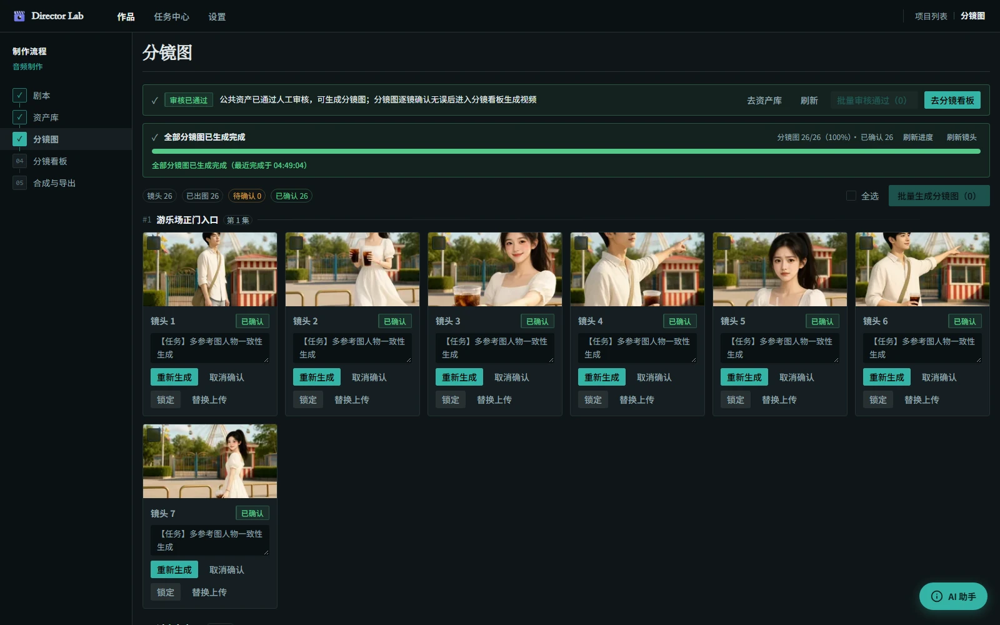

</td>
<td width="50%">

<h3>04 分镜图批量生成</h3>
<p>基于已审核公共资产批量生成分镜参考图，支持多参考图绑定、角色 / 场景 / 道具一致性校验和单镜头重生成。</p>
<p><code>已实现</code></p>

</td>
</tr>
<tr>
<td width="50%">

<h3>05 分镜看板与链式视频</h3>
<p>镜头详情包含景别、时长、人物动作、站位、道具、对白、参考图职责和视频提示词。</p>
<p>视频按镜头序号串行生成，上一镜尾帧自动绑定为下一镜首帧；失败会级联取消，避免缺参数生成。</p>
<p><code>已实现</code></p>

</td>
<td width="50%">

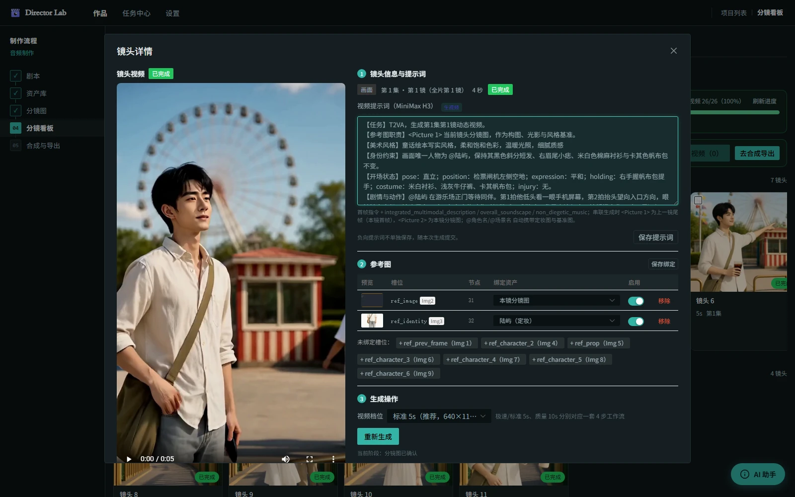

</td>
</tr>
<tr>
<td width="50%">

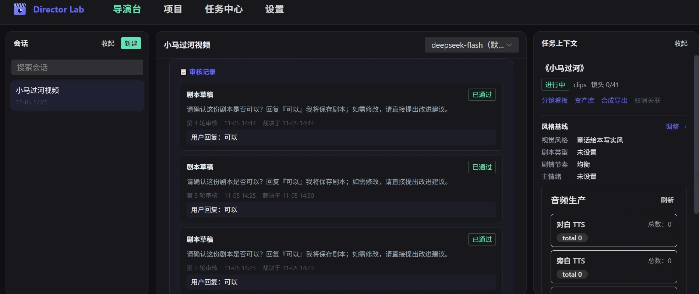

</td>
<td width="50%">

<h3>06 AI 导演台</h3>
<p>内置单 Agent 助手：意图识别、项目上下文、28 个工具调用、会话记忆和人工审批门控。</p>
<p>高风险操作先生成任务卡，经确认后才真正执行；执行过程通过事件流回传。</p>
<p><code>部分实现</code>（单 Agent 工具调用已落地，多步自主规划与流式输出仍在开发）</p>

</td>
</tr>
<tr>
<td width="50%">

<h3>07 配音与音频处理</h3>
<p>角色音色绑定、Qwen3-TTS 台词生成、Stable Audio BGM。视频与配音解耦：H3 原生音频可按策略保留或丢弃，TTS 独立生成后进入最终混音。</p>
<p><code>已实现</code>（BGM 自动 Ducking 尚未实现）</p>

</td>
<td width="50%">

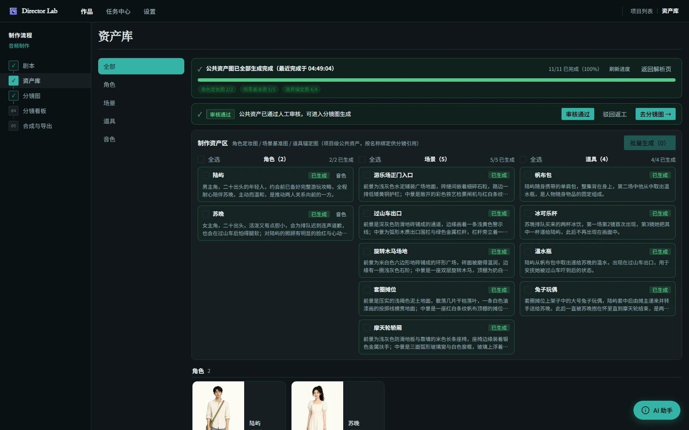

</td>
</tr>
<tr>
<td width="50%">

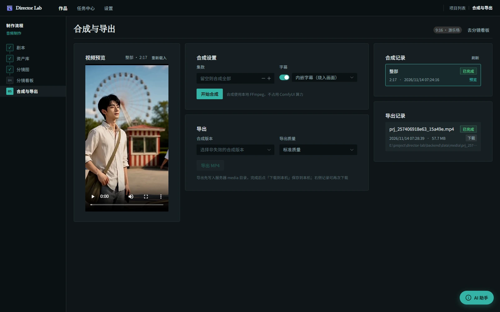

</td>
<td width="50%">

<h3>08 合成与导出</h3>
<p>FFmpeg 完成镜头拼接、音轨混合、字幕烧录、时长对齐和成片导出。</p>
<p>示例项目导出 2:17、57.7 MB 的竖屏成片，可直接在页面预览与下载。</p>
<p><code>已实现</code></p>

</td>
</tr>
</table>

## 系列与任务中心

<table>
<tr>
<td width="50%">

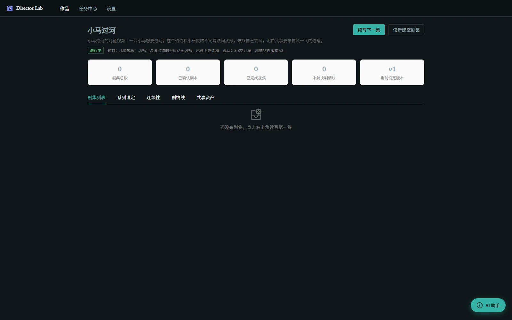

<sub>系列管理：设定、剧集、剧情事实、连续性状态与共享资产。当前为部分实现，单集生产仍走项目工作台。</sub>

</td>
<td width="50%">

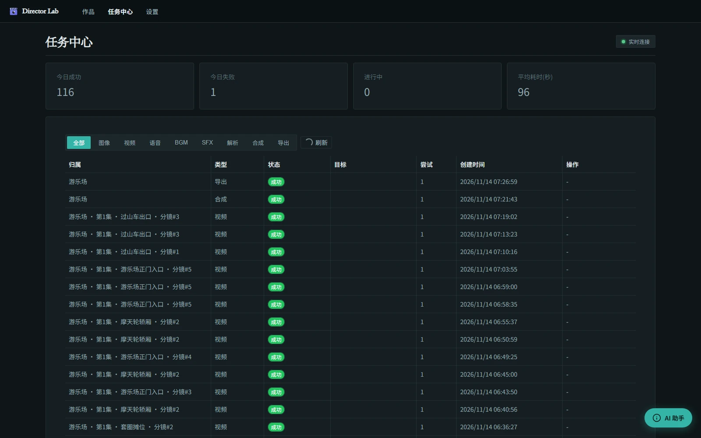

<sub>任务中心：图像 / 视频 / 语音 / BGM / 解析 / 合成 / 导出统一排队，实时状态推送、重试与失败对账。</sub>

</td>
</tr>
</table>

## 完整生产流程

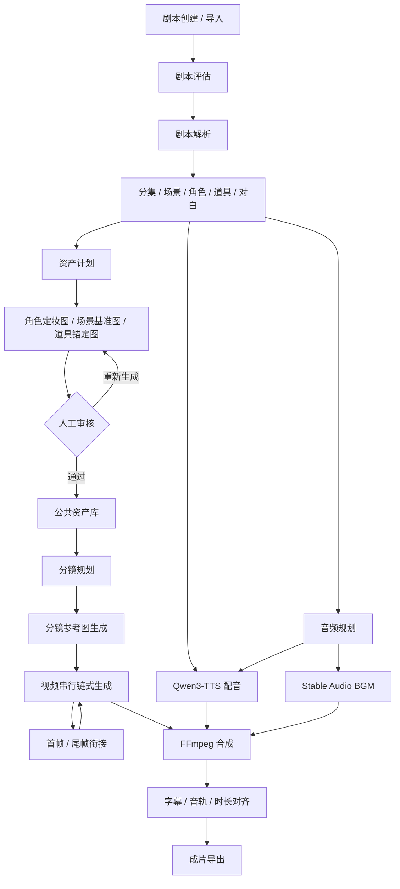

关键设计：

- **资产先行**：先生成并审核角色、场景、道具，再进入分镜和视频，避免每个镜头从零描述。
- **版本化**：资产、分镜图、视频、音频都以版本号递增，重生成不覆盖历史。
- **链式视频**：按镜头序号串行执行，前镜尾帧自动成为后镜首帧，保证动作和场景连续。
- **音画解耦**：TTS 与 H3 视频生成分开，最终在合成阶段混合，便于单独替换配音。
- **人工门控**：资产审核、镜头审核、Agent 高风险操作都需要人工确认。

## Demo Gallery

以下图片与视频均为示例项目《游乐场》的真实生成结果，素材来自 `backend/data/media/`，为控制仓库体积做了压缩或转码。

### 角色定妆图

<table>
<tr>
<td align="center" width="50%"><br><sub>陆屿 · 男主角 · 角色定妆图</sub></td>
<td align="center" width="50%"><br><sub>苏晚 · 女主角 · 角色定妆图</sub></td>
</tr>
</table>

### 场景基准图

<table>
<tr>
<td align="center" width="50%"><br><sub>游乐园入口 · 场景基准图</sub></td>
<td align="center" width="50%"><br><sub>摩天轮轿厢 · 场景基准图</sub></td>
</tr>
</table>

### 道具锚定图

<table>
<tr>
<td align="center" width="50%"><br><sub>帆布包 · 贯穿多镜头的角色道具</sub></td>
<td align="center" width="50%">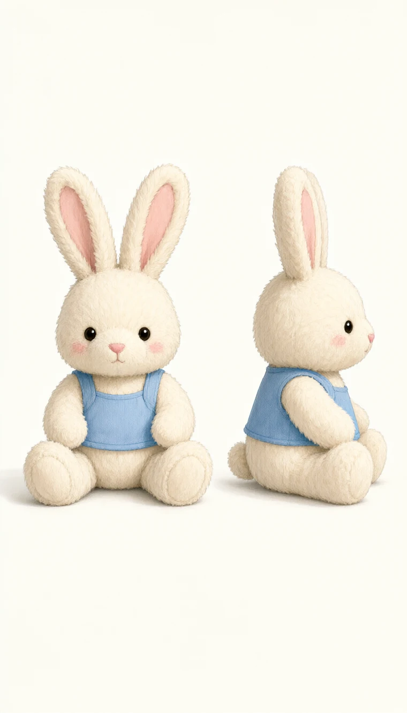<br><sub>兔子玩偶 · 剧情关键道具</sub></td>
</tr>
</table>

### 分镜参考图

<table>
<tr>
<td align="center" width="25%">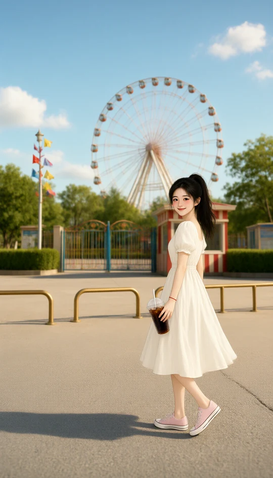<br><sub>第 7 镜</sub></td>
<td align="center" width="25%">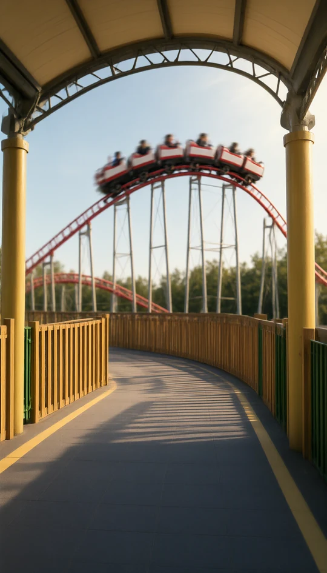<br><sub>第 8 镜</sub></td>
<td align="center" width="25%">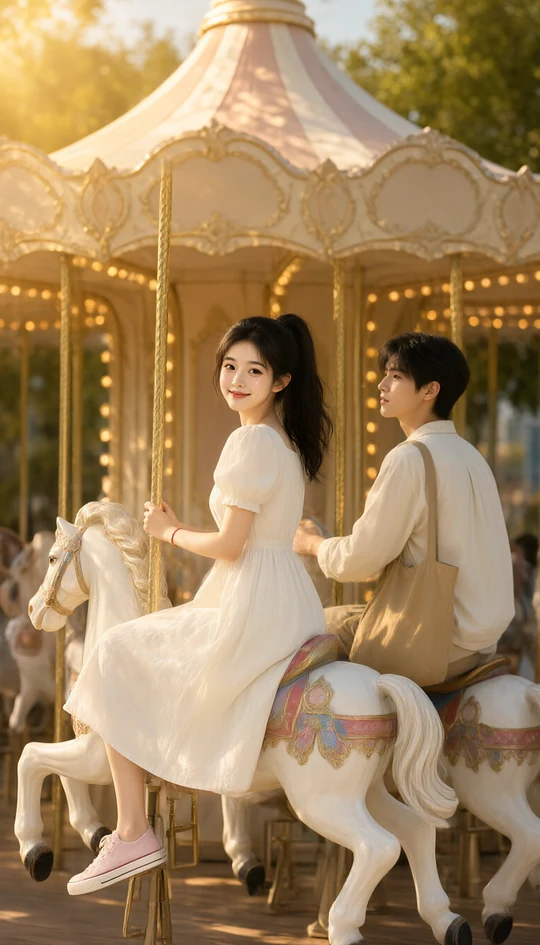<br><sub>第 12 镜</sub></td>
<td align="center" width="25%"><br><sub>第 16 镜</sub></td>
</tr>
</table>

同一角色在不同镜头中保持发型、服装、道具和面部特征一致，场景与道具由公共资产绑定，而不是每个镜头重新抽卡。

### 从分镜到成片

<table>
<tr>
<td align="center" width="33%"><br><sub>① 分镜参考图</sub></td>
<td align="center" width="33%"><br><sub>② H3 生成的视频帧</sub></td>
<td align="center" width="33%"><a href="https://github.com/user-attachments/assets/0838916c-3ce9-4791-80ba-39aefc2b0119"><br><sub>③ 最终成片（点击在线播放）</sub></a></td>
</tr>
</table>

最终成片包含角色对白、配音、BGM 和烧录字幕。

### 完整成片 · 在线播放

GitHub 会过滤 README 中的 `<video>` 标签，无法内嵌播放器。点击下方封面或播放按钮，会在新标签页用浏览器播放器在线播放，无需下载：

<div align="center">
<a href="https://github.com/user-attachments/assets/0838916c-3ce9-4791-80ba-39aefc2b0119">
  
</a>

<br>

<a href="https://github.com/user-attachments/assets/0838916c-3ce9-4791-80ba-39aefc2b0119"><b>▶ 在线播放 2:12 完整成片</b></a>

<sub>540×960 · H.264 + AAC · 原始导出为 720×1280、57.7 MB · 也可以从仓库下载 <a href="assets/readme/gallery/video/demo-final.mp4">demo-final.mp4</a></sub>
</div>

## 技术架构

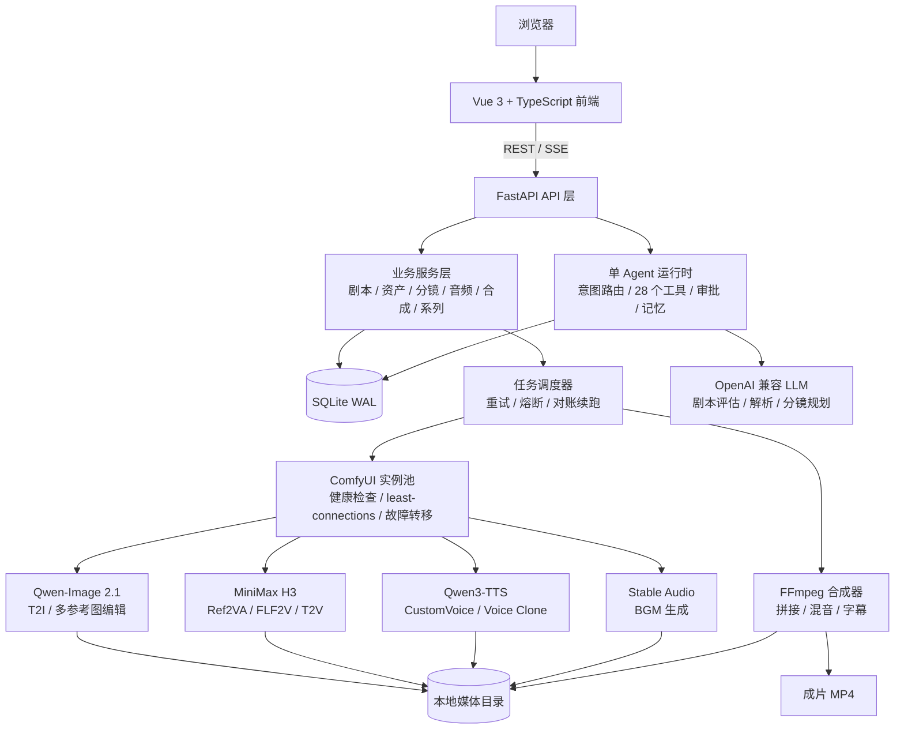

### 技术栈

| 层 | 技术 |
| --- | --- |
| 前端 | Vue 3、TypeScript、Vite、Naive UI、Pinia、TanStack Query |
| 后端 | FastAPI、SQLAlchemy 2.0、Alembic、Pydantic v2、Uvicorn |
| 数据 | SQLite（WAL 模式）+ 本地媒体目录 |
| Agent | 单 Agent 工具调用、28 个注册工具、意图路由、审批门控、会话记忆、SSE 事件 |
| LLM | OpenAI 兼容接口，支持 DeepSeek / OpenAI / Qwen / Ollama / 自定义 |
| 图像 | Qwen-Image-2.1 Turbo（文生图）、Qwen-Image 多参考图编辑 |
| 视频 | MiniMax H3 Ref2VA（fast / std / quality）、FLF2V、T2V |
| 音频 | Qwen3-TTS CustomVoice / Voice Clone、Stable Audio BGM、FFmpeg |
| 渲染 | 自建 ComfyUI，多实例池 + 内网穿透扩展 |
| 规模 | 227 个 HTTP 操作、28 个 Agent 工具、624 个后端测试用例 |

### 工程化设计

- **ComfyUI 实例池**：心跳探测 + 自动摘除恢复、least-connections 负载派发、任务级故障转移。
- **任务队列**：统一调度生成 / 合成 / 导出 / 解析执行器，支持重试、熔断与对账续跑。
- **一致性控制**：跨集连续性记录、首帧使用追踪、图像质量门控、验收检查。
- **可观测性**：任务进度事件、SSE 推送、任务中心按类型筛选、错误信息回传。
- **安全边界**：媒体上传、工作流解析、外部 URL、FFmpeg 执行均有大小、时长、路径与资源限制；凭据只走环境变量，不写入日志。

## 快速开始

### 环境要求

- Python ≥ 3.11
- Node.js ≥ 20
- ffmpeg ≥ 6.0
- 可用的 NVIDIA GPU 与 ComfyUI 运行环境
- 磁盘：H3 / Qwen 两组模型约 66 GiB，TTS 模型另计，建议预留 80 GB 以上

> 平台界面和任务管理可以先启动，但没有可用的 ComfyUI 实例时无法执行真实的图片、视频和 TTS 生成。

### 1. 部署 ComfyUI 渲染底座

`docs/model/` 提供一键部署脚本，会自动完成环境检查、安装 ComfyUI、下载模型、校验文件并启动服务：

```bash
cd docs/model

# AutoDL / GPU 容器
python autodl_comfyui_qwen21_h3_setup.py all --groups h3 qwen tts --port 8188

# CloudStudio / 通用 Linux
python cloudstudio_comfyui_qwen21_h3_setup.py all --groups h3 qwen tts --port 8188

# 查看计划、状态、日志
python autodl_comfyui_qwen21_h3_setup.py plan
python autodl_comfyui_qwen21_h3_setup.py status
python autodl_comfyui_qwen21_h3_setup.py log --lines 80
```

核心模型（实际清单以脚本内 `MODELS` 定义为准）：

| 组 | 模型 | 用途 | 大小 |
| --- | --- | --- | --- |
| `h3` | `minimax_h3_ref2va_pruned_int8_convrot.safetensors` | H3 Ref2VA 视频生成 | ≈ 20.97 GB |
| `h3` | `qwen3vl_32b_minimax_h3_int8_convrot.safetensors` | H3 文本编码器 | ≈ 27.14 GB |
| `h3` | `minimax_h3_video_vae_fp16.safetensors` / `minimax_h3_audio_vae_fp32.safetensors` | 视频 / 音频 VAE | ≈ 5.82 GB |
| `qwen` | `qwen_image_2.1_turbo_int8_convrot.safetensors` | Qwen-Image 2.1 图像生成 | ≈ 7.26 GB |
| `qwen` | `qwen3vl_8b_int8_convrot.safetensors` | Qwen-Image 文本编码器 | ≈ 9.35 GB |
| `tts` | `Qwen3-TTS-12Hz-1.7B-CustomVoice/` | 角色配音 | ≈ 3.5 GB+ |

显存吃紧时可追加 `h3vram`（NVFP4 文本编码器），出片提速可追加 `h3speed`（INT8 视频 VAE + 4-step Turbo LoRA）：

```bash
python autodl_comfyui_qwen21_h3_setup.py download --groups h3speed
python autodl_comfyui_qwen21_h3_setup.py download --groups h3vram
```

### 2. 启动后端

```bash
cd backend
python -m venv .venv

# Windows
.venv\Scripts\activate
# Linux / macOS
# source .venv/bin/activate

pip install -e ".[dev]"
alembic upgrade head
uvicorn app.main:app --host 127.0.0.1 --port 8000
```

### 3. 配置模型服务

在 `backend/.env` 中配置 ComfyUI 与 LLM：

```bash
# ComfyUI
DLAB_COMFYUI_BASE_URL=http://127.0.0.1:8188

# LLM（OpenAI 兼容接口，示例为 DeepSeek）
DLAB_LLM_PROVIDER=deepseek
DLAB_LLM_BASE_URL=https://api.deepseek.com
DLAB_LLM_MODEL=deepseek-chat
DLAB_LLM_API_KEY=your-api-key
```

ComfyUI 实例和语言模型也可以在应用内配置（设置页），配置写入 `backend/data/runtime_settings.json`，保存后立即生效，无需重启服务。

**ComfyUI 多实例**

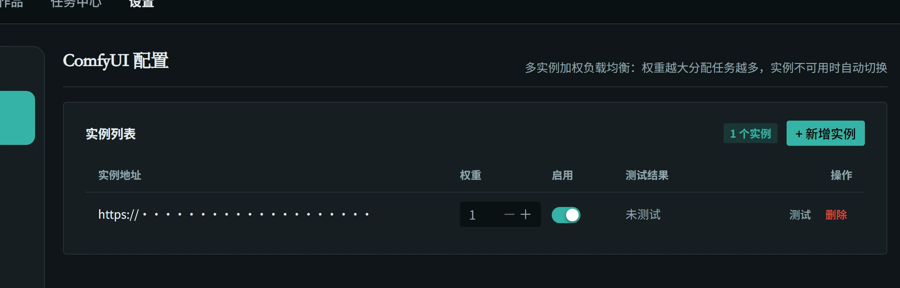

- 实例列表支持新增、删除、行内修改权重和启用状态，改动自动保存；
- 每个实例可单独测试连通性，返回延迟或失败原因；
- 权重越大分配到的生成任务越多，实例不可用时自动切换到其他实例。

**语言模型**

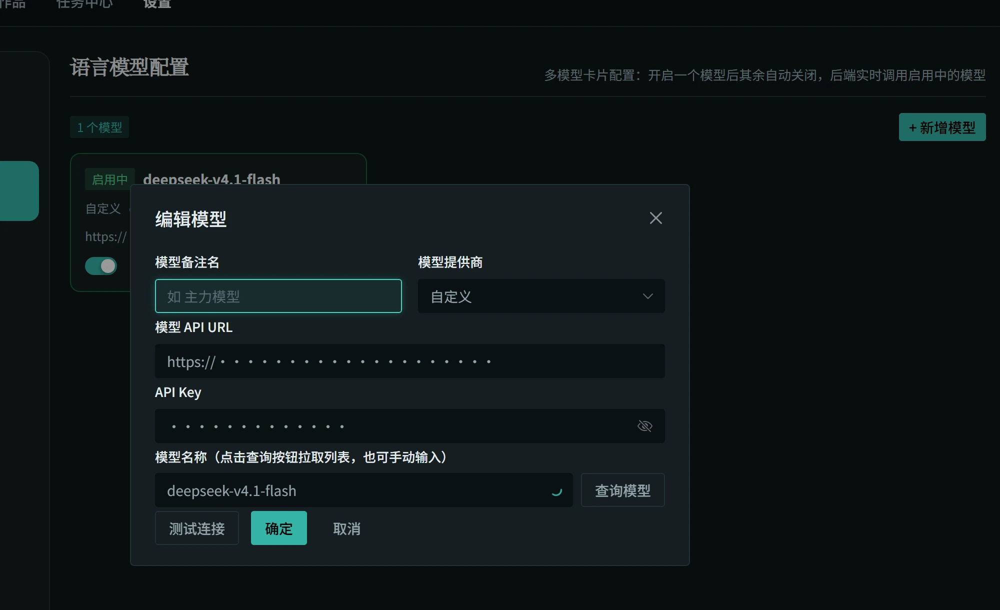

- 支持 DeepSeek / OpenAI / Ollama / 自定义（OpenAI 兼容接口），切换提供商会自动填充默认 API URL；
- 每张模型卡片独立配置 API URL、API Key 和模型名，可一键拉取模型列表后选择；
- 同一时刻只有一个模型处于启用状态，开启新模型会自动关闭其他模型，可逐卡片测试连接。

> 截图中实例地址、API URL 与 API Key 已打码。

### 4. 启动前端

```bash
cd frontend
npm install
npm run dev
```

打开 `http://localhost:5173`。开发服务器会把 `/api` 代理到 `http://127.0.0.1:8000`。

### 5. 跑通第一个作品

1. 新建作品，粘贴或导入剧本；
2. 在剧本页完成评估与解析；
3. 进入资产库，生成并审核角色、场景、道具；
4. 生成分镜图，确认后进入分镜看板；
5. 按镜头顺序生成视频；
6. 在合成页生成 / 审核配音与 BGM；
7. 导出成片。

### 测试

```bash
cd backend && .venv/bin/python -m pytest tests/ -v   # 624 个后端测试用例
cd frontend && npm run build
```

> Windows 下将 `.venv/bin/` 替换为 `.venv\Scripts\`。

## 项目结构

```text
director-lab/
├── backend/
│   ├── app/
│   │   ├── api/v1/          # REST 接口：剧本 / 资产 / 分镜 / 生成 / 音频 / 合成 / Agent
│   │   ├── services/        # 业务服务：解析、资产计划、分镜链、语音匹配、一致性、Agent
│   │   ├── integrations/    # ComfyUI 客户端与实例池
│   │   ├── worker/          # 调度器与生成 / 合成 / 导出 / 解析执行器
│   │   └── core/            # 配置、数据库、日志
│   ├── data/workflows/      # ComfyUI 工作流定义（H3 / Qwen / TTS / BGM）
│   ├── tests/               # 624 个后端测试用例
│   └── alembic/             # 数据库迁移
├── frontend/
│   └── src/                 # Vue 3 页面、组件、状态与 API 客户端
├── docs/
│   ├── model/               # ComfyUI 与模型一键部署脚本
│   ├── agent/               # Agent 设计、审计与交付记录
│   ├── series/              # 系列 / 多集连续性设计与实现报告
│   └── img/                 # 历史页面截图
├── assets/readme/           # 本 README 使用的截图、作品与视频
└── README.md
```

## 当前状态与路线图

| 能力 | 状态 | 说明 |
| --- | --- | --- |
| 剧本创建 / 评估 / 解析 | 已实现 | 支持分集、场景、角色、道具、对白解析 |
| 角色 / 场景 / 道具资产库 | 已实现 | 审核、版本化、重新生成、跨镜头复用 |
| 分镜规划与分镜图生成 | 已实现 | 多参考图绑定、一致性校验、批量生成 |
| 视频串行链式生成 | 已实现 | H3 Ref2VA / FLF2V / T2V，尾帧接首帧 |
| TTS 配音 / BGM / 合成导出 | 已实现 | 音画解耦、FFmpeg 混音与字幕 |
| AI 导演台 | 部分实现 | 单 Agent 工具调用、审批、记忆；多步自主规划与流式输出开发中 |
| 系列 / 多集连续性 | 部分实现 | 数据模型、页面和连续性规则已落地，完整多集生产链路验证中 |
| BGM Ducking / SFX 素材库 | 规划中 | 当前 BGM 为固定音量 + 结尾淡出 |
| 多用户 / 权限体系 | 未开始 | 当前定位为单用户自托管工作台 |

## 已知限制

- **必须自备渲染算力**：仓库不包含模型权重，真实生成依赖可用的 ComfyUI 与 GPU。
- **不是全自动黑盒**：资产审核、镜头审核和 Agent 高风险操作保留人工确认，这是刻意设计。
- **Agent 仍是单 Agent**：已具备意图识别、工具调用和审批，但尚未实现多步任务规划运行时与多 Agent 协作。
- **系列能力尚在完善**：系列页面、数据模型和连续性规则已落地，完整多集生产仍未作为主链路验证。
- **示例数据不在仓库中**：`backend/data/` 已被 `.gitignore` 忽略，README 只保留压缩后的展示素材。

## 文档

| 文档 | 内容 |
| --- | --- |
| [ARCHITECTURE.md](docs/ARCHITECTURE.md) | 状态机、任务队列、部署与备份 |
| [API.md](docs/API.md) | HTTP 接口定义 |
| [DATABASE.md](docs/DATABASE.md) | 表结构与数据字段 |
| [WORKFLOW.md](docs/WORKFLOW.md) | 工作流上传、校验、注入与 H3 生成 |
| [PROMPTS.md](docs/PROMPTS.md) | 剧本解析与分镜设计的 LLM 层规则 |
| [FRONTEND.md](docs/FRONTEND.md) | 前端页面、样式与交互 |
| [DEVELOPMENT.md](docs/DEVELOPMENT.md) | 环境搭建、启动、测试与部署 |
| [docs/agent/](docs/agent/) | Agent 设计、审计与迭代记录 |
| [docs/series/](docs/series/) | 系列 / 多集连续性设计与实现报告 |

## 素材说明

README 中的界面截图来自本地真实运行的产品；作品素材来自示例项目《游乐场》的实际生成结果，全部经过压缩：

- 截图：`docs/img/` 与 `assets/readme/screenshots/`，统一转为 WebP 以减小体积；
- 角色 / 场景 / 道具 / 分镜：`assets/readme/gallery/`，由原始 PNG 转为 WebP；
- 视频：`assets/readme/gallery/video/`，包含 3 秒 GIF 预览、2:12 压缩成片 MP4 与成片海报帧；
- 截图中的实例地址、API URL、API Key 均已打码；
- 原始媒体位于 `backend/data/media/`，因体积与数据安全原因不入库。

## License

当前仓库尚未声明开源许可证。如需商用、二次分发或用于闭源产品，请先联系作者确认授权。

## 致谢

- [ComfyUI](https://github.com/comfyanonymous/ComfyUI) 提供本地渲染底座；
- Qwen-Image、MiniMax H3、Qwen3-TTS 提供图像、视频与语音模型；
- [FastAPI](https://fastapi.tiangolo.com/)、[Vue](https://vuejs.org/)、[Naive UI](https://www.naiveui.com/)、[FFmpeg](https://ffmpeg.org/) 提供工程基础。

---

<div align="center">

如果 Director-Lab 对你有帮助，欢迎点一个 Star，或提交 Issue / PR 一起完善这条短剧生产流水线。

</div>
