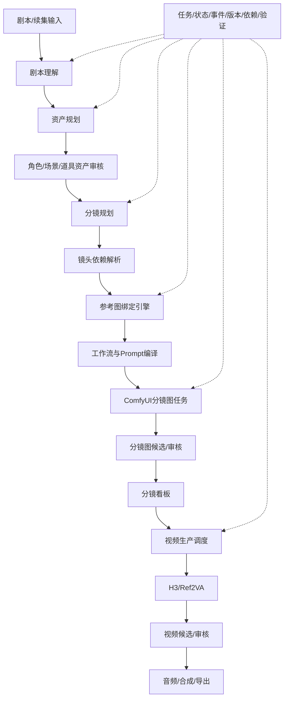

# Director-Lab 全链路生产架构重构执行 Plan

> **交付目标：** 交由 coding Agent 对 Director-Lab 现有项目执行渐进式重构。  
> **本地项目：director-lab
> **执行原则：** 先审计最新源码 → 输出可执行计划与风险 → 分阶段实施 → 测试 → 验收 → 记录，不得凭想象改代码，不得推倒重写。
>
> 本文是执行指令，不是架构讨论稿。Agent 必须将计划落实到当前项目代码、数据库、接口、前端、测试与文档中；若当前代码结构与文档不一致，以实际代码为准，并先更新计划说明差异。

---

## 0. Agent 执行规则（必须遵守）

你是 Director-Lab 的高级架构师、后端工程师、前端工程师、ComfyUI 工作流工程师、测试工程师。请针对当前仓库执行全链路重构。

### 0.1 先审计当前实现，不允许猜测

开始前：

1. 检查 Git 分支、工作区状态、最近提交、当前项目目录。
2. 读取前后端 README、架构文档、数据库迁移、配置、工作流定义、Prompt 文件、测试。
3. 追踪实际代码链路，重点阅读：
   - 剧本输入、校验、解析、分集/续集处理
   - 剧本分析、实体抽取、实体归一化、合并、分段、重试、恢复
   - 角色/场景/道具资产 CRUD、图片生成、资产审核与版本
   - 分镜规划、分镜数据、镜头 CRUD、镜头排序
   - 分镜图生成、参考图收集、槽位绑定、工作流编译、ComfyUI调用
   - 分镜看板、批量操作、任务状态、图片候选、审核
   - I2V / H3 / Ref2VA、首帧/参考图/尾帧、镜头连续性
   - TTS、音轨、视频合成、导出
   - Agent、worker、队列、并发、事件、取消、重试、失败恢复
   - 前端页面、组件、状态管理、API、轮询/事件流、错误处理
4. 追踪关键函数调用链与数据来源，记录哪些逻辑重复、耦合、硬编码、职责混乱。
5. 检查真实数据库表、字段、索引、约束、现有迁移历史。禁止假设数据库结构。
6. 检查实际工作流 JSON 与节点输入。槽位规则必须依据实际工作流，不可凭旧文档或猜测。
7. 运行现有测试、lint、类型检查及可运行的构建，记录当前基线失败，避免将既有问题误认为重构引入。
8. 审查代码库中已有方案，尽量复用已有模块、Job/Event、Prompt模板、版本、恢复机制。

**审计后先生成 `docs/refactor/director_lab_refactor_audit.md`**，包括：
- 当前架构及真实流程图
- 当前模块/文件与职责
- 当前数据模型与关系
- 当前工作流与槽位事实
- 当前任务状态、队列和并发事实
- 现有能力可保留列表
- 问题清单（按严重程度、代码位置、触发条件）
- 本 Plan 与当前实现不一致之处
- 分阶段实施计划、依赖、估算/风险、验收方式

审计完成后直接开始执行，不要只停留在审计报告或要求用户再次确认；除非发现数据破坏风险、无法回滚的迁移、关键需求冲突或环境缺失而无法安全继续。

### 0.2 保护现有功能

不得擅自删除或破坏：

- 现有项目、剧本、分集、资产、分镜、图片、视频、任务数据
- 已可用的 ComfyUI workflow 与节点配置
- H3 / Ref2VA 视频生成流程
- 当前 TTS、音频、合成、导出能力
- 资产库已有图片、版本、生成记录
- 项目续集/历史资产复用能力（如已实现）
- 现有 API 合约、前端路径和用户操作习惯，除非完成兼容方案

不要：
- 一次性重写所有解析和生产代码
- 创建大量无实际用途的 Agent 或微服务
- 将槽位编号写死在 Prompt 或业务逻辑中
- 用“LLM输出 JSON 合法”代替数据和语义验证
- 无依据自动覆盖已审核资产或镜头
- 资产变更后自动删除旧生成结果
- 把依赖关系、任务状态、审核状态混成一个 `status`
- 在未验证真实工作流节点结构前修改工作流
- 将复杂生产逻辑全部堆在一个前端页面或一个 Agent Prompt
- 未完成测试就迁移或清理旧逻辑

### 0.3 执行、记录与交付

每个 Phase：
1. 先列本阶段实施清单和影响范围。
2. 实施代码、DB、API、UI、测试和文档（仅涉及项）。
3. 运行本阶段测试与项目适用的全套检查。
4. 记录结果、问题和修复。
5. 更新 `docs/refactor/director_lab_refactor_progress.md`。
6. 只有满足阶段验收才进入下一阶段；未满足则修复或明确阻塞。

在最终输出中说明实际修改文件、迁移、测试结果、未完成项、风险和回滚方法。不要宣称执行了实际未执行的测试。

---

# 1. 重构目标与边界

## 1.1 目标

Director-Lab 是以剧本为输入，生成短剧视频的制作系统。重构目标是让其生产链路可理解、可审计、可恢复、可局部重跑，并减少 LLM 输出不稳定、参考图错位、资产变更导致的隐性失效和生产状态混乱。

目标流程：

**剧本输入/续集 → 剧本理解 → 资产规划/审核 → 分镜规划 → 镜头依赖解析 → 参考图绑定 → 分镜图生成/审核 → 分镜看板 → 视频生成/连续性 → 音频/合成/导出**

模块之间通过明确的数据契约和依赖关系连接。LLM负责语义理解、创意分析、规划和生成内容；程序负责ID、依赖、工作流输入编译、槽位分配、状态机、校验、调度、版本与恢复。

## 1.2 非目标（此次禁止无必要扩展）

- 不重新设计整个视频模型/H3架构。
- 不迁移或更换ComfyUI。
- 不重新实现TTS或音频合成。
- 不改变已确认的音频与视频生产策略，除非审计发现当前实现和产品约定冲突，并单独记录。
- 不新增与本次核心生产链路无关的商业功能。
- 不为架构而架构，避免微服务化、过度抽象、无必要的表/Agent/队列。
- 不要求一次实现所有未来高级能力；必须保证当前工作流稳定并留出可扩展边界。

---

# 2. 目标架构

## 2.1 分层

### A. Script Intelligence（剧本理解层）
- 原文索引与结构化区块
- 故事分析
- 场景/剧情节点（Beat）分析
- 角色、场景、道具候选提取
- 实体归一化与引用
- 影视化风险/逻辑检查
- 质量审核与用户确认

### B. Asset Planning & Asset Library（资产规划与资产库）
- 角色/场景/道具资产定义与复用
- 资产候选归一化、去重、合并
- 资产描述与视觉规范
- 资产图片生成任务
- 资产图审核、版本与替换
- 资产使用关系与影响范围

### C. Storyboard Planning（分镜规划层）
- 场景内剧情Beat与镜头规划
- 镜头拆分、顺序、景别、构图、动作、时长
- 对白/旁白/声音信息
- 角色/场景/道具ID绑定
- 镜头之间的动作、空间、道具、时间连续性关系
- 镜头规划审核与局部重规划

### D. Reference Binding & Storyboard Image Production（参考图绑定与分镜图生产）
- 依赖解析
- 资产图片版本选择
- 工作流槽位定义读取
- Binding Policy（绑定策略）
- 槽位容量、必填、冲突与缺失检查
- Prompt编译
- Workflow编译
- ComfyUI任务执行
- 候选图片、审核、版本、快照
- 失败恢复和局部重生成

### E. Storyboard Board（分镜看板）
- 镜头列表/卡片/时间序列
- 镜头编辑、排序、筛选
- 生产状态与依赖状态
- 分镜图候选和审核
- 绑定快照/槽位检查
- 批量操作
- 任务控制
- 变更影响提示
- 历史与回滚

### F. Video Production（视频生产层）
- 视频Prompt与workflow编译
- H3/Ref2VA生成
- 参考图与首帧/尾帧关系
- 视频任务调度与恢复
- 音频/TTS/BGM/SFX（保持现有边界）
- 视频审核、合成、导出
- 镜头连续性检查

### G. Shared Production Infrastructure（共享基础设施）
- Job/Task
- 状态机
- 事件/进度
- Scheduler/Concurrency
- Retry/Timeout/Cancellation
- Dependency Graph
- Version Snapshot
- Validation/Audit
- Logs/Observability
- Idempotency

## 2.2 架构示意



---

# 3. Phase 0：源码审计、基线与技术方案校准

## 3.1 审计

- 全面梳理现有流程入口与后台任务。
- 识别解析/生成逻辑的重复代码。
- 识别所有 Prompt、模板、工作流JSON、配置和硬编码槽位。
- 识别分镜图任务是否镜头级、批次级、项目级，以及任务间依赖。
- 识别分镜看板实际使用的数据来源、API和状态。
- 识别资产图片当前是否有版本/审核/锁定/替换逻辑。
- 识别上一镜尾帧当前是如何获取、是否存在循环依赖。
- 识别视频任务中图像槽位与参考音频/人物参考的关系；不误改当前 H3 约定。
- 检查API响应、错误、前端loading、轮询、Event/SSE/WebSocket机制。
- 检查数据库迁移和数据兼容性。

## 3.2 基线测试

运行并记录：
- 后端单测/集成测试
- 前端lint/typecheck/build
- API测试
- 工作流编译/校验测试
- Job/Event测试
- ComfyUI可用的模拟测试或真实环境验证（区分环境）
- 当前存在的失败、警告、性能问题

## 3.3 交付

`docs/refactor/director_lab_refactor_audit.md`、进度文档、基线报告。

**验收：** 有真实代码位置、真实数据关系、真实工作流槽位结构的审计，不仅是架构猜想。

---

# 4. Phase 1：剧本理解与资产规划分离

## 4.1 剧本原文索引

在不破坏原文的情况下，创建可追溯的原文结构：
- 原始剧本文本保留
- 标记剧集/章节/场景/段落/对白/动作等（依据现有格式）
- 生成稳定的 `source_block_id` 或等价引用
- 记录原文区块顺序、范围/文本、来源版本
- 分析输出可以引用原文区块
- 续集或更新剧本时，原文版本有清晰区分

不得因结构化而丢失原文，也不得强行格式化用户输入造成内容损失。

## 4.2 Story Analysis独立

只分析故事，不同时生成镜头Prompt或图片Prompt。

产出尽可能结构化：
- 故事梗概
- 类型、基调、风格（依据原文）
- 主题（可选，需区分推断）
- 主角、人物关系
- 主角目标
- 核心矛盾
- 关键事件
- 转折
- 高潮
- 结局/悬念
- 故事逻辑疑点
- 原文证据引用

Story Analysis不得把创意推断当作剧本事实。必要字段标记 `source/evidence` 或 confidence。

## 4.3 Scene / Beat Analysis

将剧情组织为场景与剧情Beat，不直接生成最终镜头。

Scene：
- 稳定ID
- 场景名
- 原文引用
- 地点/时间
- 内外景/时段（若原文有或明确推断）
- 场景人物
- 场景动作概述
- 场景转换关系
- 可复用场景资产关联

Beat：
- 稳定ID
- 原文引用
- 事件
- 事件前状态/后状态
- 参与角色
- 重要道具
- 目的、阻碍、结果（适用时）
- 情绪/戏剧功能（可选）
- Beat之间关系

Beat不是镜头。一个Beat可以由多个镜头表达，多个Beat也可能在同一镜头内表达，但应由后续分镜规划决定。

## 4.4 Asset Analysis独立

分别处理角色、场景、道具，允许独立重跑，统一ID引用。

Character：
- 名称/别名/描述
- 剧情角色定位
- 关系
- 外观特征、服装、年龄外观等非敏感剧情描述
- 出场场景与原文证据
- 视觉一致性约束
- 角色资产候选/已有资产引用

Location：
- 名称/别名
- 空间布局、结构
- 时间/天气/光照（依据原文或明确推断）
- 场景用途
- 可复用范围
- 不应将角色或剧情道具直接写入场景基准图定义（除非当前资产类型明确允许；场景图原则上保持纯场景）

Prop：
- 名称/别名
- 外观/尺寸/材质
- 使用场景
- 角色持有/使用关系
- 道具生命周期（出现、持有、放置、交接、丢失、破坏等）
- 关键性
- 可复用资产引用
- 避免道具图片混入人物或场景

资产分析要基于原文和Story/Scene/Beat上下文，独立重跑时保留用户审核和已确认资产关联。

## 4.5 Production Readiness / 风险分析

生成生产风险，不生成最终分镜Prompt：
- 多角色复杂镜头
- 角色身份混淆
- 关键道具交接/消失/持有连续性
- 动作复杂度
- 视觉上难以表现的叙述
- 场景空间与站位冲突
- 对白时长与镜头时长风险
- 旁白/字幕/声音需求
- 需要特殊参考图的镜头/资产
- 内容覆盖缺口

风险必须提供来源、关联对象、建议处理方法与级别。

## 4.6 Validator与审核

程序验证：
- ID和引用合法
- 必需字段
- 原文引用有效
- 重复实体
- 场景/角色/道具关系
- Beat与Scene关联
- 结构完整性
- 数量/范围约束

LLM语义审计：
- 分析是否漏剧情
- 人物关系是否错误
- 资产是否误提取
- Scene/Beat是否覆盖原文
- 是否将推断当事实
- 风险是否合理

程序验证和语义审计分开；失败允许局部重跑。

## 4.7 用户审核门

在进入生产阶段前，提供清晰审核结果：
- 故事分析
- Scene/Beat
- 角色
- 场景
- 道具
- 风险
- 缺失与疑点

用户审核/确认必须可追踪。根据当前项目设计，避免引入过多审批卡点，但不得未经确认就把有明显错误的资产数据推入生成流程。

## 4.8 迁移策略

- 先Shadow Run：新分析与现有解析结果并行，独立保存，不覆盖现有生产数据。
- 对比：实体、Scene、Beat、资产、分镜规划质量和漏项。
- 先通过内部/样例剧本验证，再逐步切换入口。
- 保留兼容Adapter将新结构转换为当前生产流程接受的格式。
- 旧流程不可在新流程未验证前删除。

---

# 5. Phase 2：分镜规划（Storyboard Planning）独立

## 5.1 目的

资产审核后，独立生成镜头规划。镜头规划负责决定故事如何被拍成镜头，但不负责图片槽位分配和ComfyUI工作流执行。

## 5.2 镜头规划输入

- 已确认剧本分析
- Scene/Beat
- 角色资产ID与视觉描述
- 场景资产ID与空间描述
- 道具资产ID、使用与生命周期
- 原文对白、旁白、动作
- 项目美术风格
- 分镜规划约束/镜头时长/目标视频时长
- 生成策略与已有配置
- 用户对镜头的修改/锁定信息（若有）

## 5.3 镜头规划输出

每个镜头有稳定ID，结构化字段应与现有数据兼容，必要时新增字段通过迁移实现。

建议字段（以实际模型为准）：
- `shot_id`
- `episode_id`
- `scene_id`
- `beat_ids`
- `sequence`
- `duration`
- `shot_type`/景别
- `camera_angle`
- `camera_motion`（图片规划中可作为视频规划建议）
- `composition`
- `visual_description`
- `action`
- `start_state`
- `end_state`
- `dialogue`
- `voiceover`
- `sound_notes`
- `character_asset_ids`
- `location_asset_id`
- `prop_asset_ids`
- `character_positions`/角色站位（必要时）
- `continuity_in`
- `continuity_out`
- `continuity_dependencies`
- `generation_constraints`
- `source_block_ids`
- `plan_version`
- `validation_status`

具体字段需根据现有结构裁剪，避免为了照搬示例过度增表。

## 5.4 分镜规划规则

- 镜头规划必须引用资产库的真实ID，不以名字作为唯一引用。
- 人物、场景、道具均应从已审核资产或明确标记的待审核候选引用。
- 分镜规划可提出新资产候选，但不得在不审核的情况下自动创建并覆盖现有资产。
- 每个镜头必须与原文/Beat有可追溯关联。
- 镜头动作应能在指定时长内表现；若过长则提出拆镜/时长风险。
- 对白/旁白不应无故改写；需要改写时显式记录变更。
- 不应为了镜头数而重复同一动作、制造原剧本没有的剧情。
- 生成镜头的分镜图Prompt与视频Prompt应在生产编译层生成/编译，不由规划层把所有细节混为一体。
- 支持镜头局部重规划，保留其他已确认镜头。
- 用户编辑或锁定镜头后，重规划必须尊重锁定范围，提供差异，不覆盖锁定内容。
- 镜头顺序、ID和场景关系应稳定，重规划不应无理由全量换ID。

## 5.5 规划质量检查

程序检查：
- Scene/Beat覆盖率
- 镜头ID唯一
- 顺序连续
- 时长合理
- 资产ID存在
- 原文证据存在
- 引用对象类型正确
- 必要对白/动作是否遗漏
- 关键道具生命周期一致性
- Scene切换合理
- 不存在循环依赖

LLM Audit：
- 镜头是否表达Beat
- 视觉可执行性
- 镜头节奏
- 角色站位/动作连续性
- 视觉信息是否过载
- 镜头之间是否不必要重复
- 关键事件是否被漏掉

审计结果要标记具体镜头ID和建议，允许针对镜头或场景局部修订。

## 5.6 规划与生成分离

分镜规划阶段不调用ComfyUI，不生成图片。规划结果通过审核/确认后进入分镜图生产阶段。

---

# 6. Phase 3：依赖关系与版本快照基础设施

这是分镜图生成和分镜看板可靠性的基础。

## 6.1 统一Dependency模型/服务

审计当前是否已有依赖/引用表或类似能力。优先扩展现有实现；只有现有结构无法满足时才新建模型。

依赖关系至少能表达：
- 镜头 → 角色资产
- 镜头 → 场景资产
- 镜头 → 道具资产
- 镜头 → Beat/原文
- 镜头 → 分镜规划版本
- 分镜图 → 镜头
- 分镜图 → 资产图片版本
- 分镜图 → 工作流版本
- 分镜图 → Prompt模板/编译版本
- 视频 → 分镜图版本
- 视频 → 参考视频/上一镜尾帧
- 任务 → 任务依赖

每条关系有明确来源、类型、目标ID和版本/快照信息。

## 6.2 Dependency Graph

提供可查询的依赖服务：
- 查询某资产被哪些镜头/图片/视频引用
- 查询某工作流版本影响哪些任务
- 查询某镜头生成所需前置依赖
- 查询某个生成结果使用了哪些输入版本
- 查询资产变更后的影响范围
- 查询镜头之间视频连续性依赖
- 检测循环、失效依赖、孤儿任务

不要让业务页面自己拼接依赖关系。

## 6.3 Version Snapshot（生成快照）

每一次生成任务都要保存输入快照（尽可能复用现有历史记录结构）：
- Project/Episode/Shot ID
- 资产ID
- 实际选用的资产图片ID/版本
- Prompt内容/模板版本/编译产物
- Workflow ID/版本/关键节点输入快照
- 槽位映射
- 任务参数
- 前置图片/视频/尾帧版本
- 时间、任务ID
- 生成结果ID
- 审核信息

快照用于可追溯、复现、依赖变更检测。不要仅保存资产ID而忽略图片版本。

## 6.4 资产变更影响

资产图或资产描述更新时：
- 不删除已有结果。
- 不默认自动重新生成。
- 查询受影响的镜头/生成结果。
- 对影响范围标记 `dependency_changed` 或等价状态。
- 区分可自动更新的未生成任务和已生成结果。
- 提供影响列表与选择重生成能力。
- 变更影响判定基于实际引用版本和依赖类型，不采用简单全项目失效。

## 6.5 工作流版本影响

- 工作流内容、节点、槽位定义发生变化时，生成工作流版本或内容Hash。
- 已生成结果保留当时快照。
- 新任务使用当前有效工作流版本。
- 对工作流变更的影响进行检测，按任务依赖决定是否标记陈旧。
- 不将所有工作流改动都视为所有镜头图片必然失效。

---

# 7. Phase 4：Reference Binding Engine（参考图绑定引擎）

## 7.1 职责边界

参考图绑定引擎是独立服务/模块，不应藏在Prompt模板、前端页面、ComfyUI调用函数或单个LLM Agent中。

负责：
1. 根据镜头及生成任务读取依赖。
2. 查询可用资产和有效图片版本。
3. 根据任务类型和工作流定义执行绑定策略。
4. 编译槽位映射。
5. 检查槽位容量、必填、重复、类型、顺序和缺失。
6. 输出可审计绑定结果与快照。
7. 在生成前阻止无效绑定或进入明确的人工处理状态。

## 7.2 工作流槽位配置

槽位定义必须来自真实工作流配置或由工作流管理页面维护并验证，不在代码或Prompt里硬编码槽位编号。

槽位配置可表达：
- workflow_id/version/hash
- workflow_task_type（例如 storyboard_image、I2V 等，按实际项目命名）
- slot_id（业务稳定ID）
- ComfyUI node_id / input_name
- input_type
- reference_role
- allowed_asset_types
- required
- min_count/max_count
- priority
- binding_policy
- compatible_reference_types
- fallback_policy
- order
- description
- enabled

可参考结构（仅示意，必须结合当前实际工作流实现）：

```json
{
  "workflow_id": "example_storyboard_workflow",
  "version": "v1",
  "slots": [
    {
      "slot_id": "scene_reference",
      "node_id": "12",
      "input_name": "image",
      "reference_role": "scene",
      "allowed_asset_types": ["location"],
      "required": false,
      "max_count": 1,
      "priority": 10
    }
  ]
}
```

## 7.3 Binding Policy（绑定策略）

策略应可配置、可测试，不由LLM直接决定槽位编号。

策略示例（名称可按项目规范调整）：
- `scene_reference`：选择已审核场景图的指定版本。
- `character_reference_by_shot_order`：按镜头角色顺序/明确角色ID绑定独立参考图。
- `prop_reference_by_usage`：绑定镜头中需要表现、且生命周期状态允许出现的道具。
- `continuity_previous_frame`：按视频/镜头连续性策略获取上一镜尾帧或其他基准帧。
- `first_frame_reference`：按视频生成策略绑定分镜图/首帧。
- `manual_override`：用户指定图片优先，记录覆盖原因和版本。
- `none`：该槽位不需要参考图。

**禁止：** 仅凭角色名称、列表索引或LLM输出序号进行不可靠绑定；必须使用稳定资产ID和角色/道具身份关系。

## 7.4 多角色绑定

多角色镜头：
- 每个角色应独立绑定其参考图。
- 明确角色ID与槽位的对应关系。
- 不以一张多人拼图作为唯一身份参考（除非工作流/用户明确选择且验证其适用性）。
- 角色数量超出工作流容量时，不悄悄丢弃角色或乱占槽位。
- 触发容量策略：选择支持更多引用的工作流、拆镜建议、降低非必要参考、用户选择等；由配置决定。
- 保存每个槽位对应的角色ID与图片版本，避免错位。
- 角色顺序需稳定且有语义，不能因排序或重试改变。

## 7.5 道具绑定与生命周期

道具不能仅因为在资产库存在就绑定到所有镜头。

依据镜头动作、Beat和道具生命周期：
- 当前镜头是否出现道具
- 是否由某角色持有
- 是否在画面中
- 是否需要道具参考
- 是否处于交接/放置/拾取/丢失/损坏状态
- 上一镜道具状态是否影响本镜
- 镜头是否允许道具消失或出现

必要时为复杂道具或角色持有关系生成组合参考（如当前项目支持）；但不强制新增独立资产类别。若确需组合图，应将其视为衍生参考图/绑定材料，不要无分析就改变资产库核心分类。

## 7.6 场景绑定

- 场景引用必须来自已确认资产。
- 场景参考应优先保持干净空间基准图，不混入角色和非场景道具。
- 通过镜头构图、景别、位置和Prompt决定镜头画面，而不是污染场景资产。
- 支持同一场景不同角度/构图需求；如果现有系统只有一张基准图，先按现有能力实施，不要假设已有多视角数据。

## 7.7 连续性参考绑定

分镜图阶段和视频阶段分别定义连续性策略，不要将上一镜尾帧无条件塞进所有图像工作流。

连续性参考可包括：
- 上一镜分镜图
- 上一镜视频尾帧
- 场景参考
- 角色参考
- 道具参考
- 当前镜头的首帧/基准图

每个参考的职责明确。由生成任务类型、镜头连续性配置、工作流能力决定是否使用。

## 7.8 绑定结果

绑定结果应包含：
- shot_id
- workflow_id/version
- slot_id
- node_id/input_name
- asset_id
- reference_image_id/version
- reference_role
- source
- ordering
- required/optional
- validation
- missing/conflict/error
- snapshot_id

绑定结果应可查看、可审计、可复现。

## 7.9 绑定校验

程序校验：
- 槽位存在且节点有效
- 参考图文件/ID有效
- 资产类型兼容
- 必填槽位
- 槽位容量
- 重复/冲突
- 角色映射稳定
- 图片版本存在
- 工作流输入类型正确
- 绑定策略可执行
- 依赖无循环
- 用户覆盖合法

生成前校验失败时：
- 阻止任务或标记需要人工处理。
- 返回可理解错误。
- 不用LLM猜槽位填充。
- 不允许将错误绑定悄悄写入工作流。

---

# 8. Phase 5：Prompt Compiler 与 Workflow Compiler

## 8.1 Prompt编译器

将规划结构、资产描述、参考图职责、镜头动作和风格规则编译成Prompt。Prompt模板外置并版本化，遵循当前项目Prompt管理方式。

分层：
- 全局美术风格/项目约束
- 场景构图与空间
- 角色身份与动作
- 道具状态
- 镜头描述
- 参考图职责（按绑定结果）
- 图像生成约束
- 输出规范

Prompt编译器：
- 不负责业务ID创建
- 不负责槽位选择
- 不直接调用ComfyUI
- 不应把绑定编号写死
- 输出可审计的Prompt与版本
- 支持用户编辑/局部修改
- 用户修改必须记录来源和版本

## 8.2 Workflow Compiler

- 根据当前工作流版本与已校验的binding snapshot编译ComfyUI输入。
- 节点映射应由workflow定义驱动。
- 检查必需节点/输入/参数类型。
- 生成前校验。
- 保存最终工作流提交快照。
- 不把工作流编译逻辑放在前端。
- 工作流变化需兼容测试。
- 不能因节点名/顺序变更造成静默错绑。

## 8.3 编译层单测

测试：
- 正常单角色
- 多角色
- 无道具
- 多道具
- 可选槽位为空
- 必填槽位缺失
- 角色超容量
- 工作流缺节点
- 节点输入类型不匹配
- 图片版本失效
- 用户手动覆盖
- 依赖变更
- 不同workflow版本

---

# 9. Phase 6：分镜图生成任务

## 9.1 镜头级任务

分镜图生产应有可追踪的镜头级任务（复用现有任务模型，不盲目新建）。

任务流程：
1. 用户发起镜头/批量生成。
2. 创建任务与输入快照。
3. 校验镜头规划。
4. 解析依赖。
5. 获取参考图。
6. 绑定槽位。
7. 验证binding。
8. 编译Prompt。
9. 编译Workflow。
10. 提交ComfyUI。
11. 追踪执行。
12. 收集候选图片。
13. 记录候选与输入快照。
14. 进入审核。
15. 审核确认/拒绝/重生成。
16. 更新镜头状态和依赖。

## 9.2 状态模型

结合现有状态实现，定义清晰状态或映射，避免重复新状态。

任务状态参考：
- `pending`
- `preparing`
- `binding`
- `validating`
- `queued`
- `running`
- `collecting`
- `succeeded`
- `failed`
- `cancelled`
- `retrying`

镜头状态与任务状态分开。任务结束不代表镜头审核通过。

## 9.3 失败与恢复

错误分类：
- 依赖缺失
- 绑定失败
- 工作流编译失败
- Prompt编译失败
- ComfyUI不可用
- ComfyUI任务失败
- 超时
- 图片读取/保存失败
- 数据库写入失败
- 取消
- 审核拒绝

支持：
- 明确错误分类
- 适当重试/退避
- 任务幂等
- 取消
- 恢复/重入
- 不重复创建无意义生成
- 记录输入快照
- 失败局部修复

## 9.4 并行调度

- 允许依赖满足的镜头并行生成。
- 根据GPU/ComfyUI资源限制并发。
- 不用无限并发。
- 任务优先级和项目级配额沿用现有策略或在审计后补足。
- 失败镜头不阻塞无依赖的镜头。
- 支持批量任务中的部分成功。
- 记录批次与子任务关系。

## 9.5 候选图片

- 支持候选图片（若当前架构支持或合理扩展）。
- 每候选记录任务、版本、绑定、Prompt、Workflow快照。
- 选定图片为当前镜头有效分镜图。
- 其他候选保留历史。
- 重新生成不覆盖旧图。
- 用户审核操作可追踪。

---

# 10. Phase 7：分镜看板（Storyboard Board）重构

## 10.1 定位

分镜看板是镜头管理、审核、生产和依赖操作工作台，不是简单图片列表，也不是生成逻辑的容器。

## 10.2 信息布局

页面以清晰、低噪音、响应式为目标，遵循当前前端框架和design system。

建议：
- 顶部：项目/集/场景过滤，生成进度，批量操作，错误/依赖提示。
- 主要内容：镜头卡片/列表/可选时间轴。
- 每个镜头：编号、场景、时长、景别、描述、分镜图、候选、审核状态、依赖状态、视频状态。
- 详情面板：镜头内容、资产绑定、参考图槽位、Prompt、工作流信息、生成历史、连续性。
- 操作入口统一，避免重复按钮、堆叠卡片、冗长提示。
- 小屏幕适配，操作不依赖hover。
- 状态用清晰且一致的视觉体系，避免颜色过度使用。

UI优先：
- 任务状态与审核状态分开显示
- 依赖异常突出
- 用户操作能立即反馈
- 详细技术信息按需展开
- 不展示虚假的高级参数/候选/状态
- 错误提供下一步行动
- 空状态与加载状态设计清晰
- 批量操作明确影响范围

## 10.3 镜头卡片

展示：
- 镜头编号
- Scene/Beat
- 时长
- 景别/运镜
- 关键人物（显示资产引用）
- 场景
- 道具
- 描述/动作
- 分镜图当前选定图
- 图片任务状态
- 审核状态
- Dependency状态
- 视频状态
- 任务失败摘要

操作：
- 查看/编辑镜头
- 修改时长/景别/动作/对白等
- 重新规划（局部）
- 查看资产
- 查看槽位绑定
- 查看生成快照
- 编辑Prompt
- 生成图片
- 生成候选/重生成
- 审核
- 生成视频
- 查看视频/尾帧
- 查看历史
- 删除（确认并处理依赖）

操作根据状态禁用/提示，而非点击后才报错。

## 10.4 详情面板

按Tab或分区展示（以实际UI布局合理选择，不要求照搬）：
- 镜头
- 资产
- 参考图绑定
- 图片生成
- Prompt
- 视频/连续性
- 历史
- 事件/错误

显示槽位绑定详情：
- slot
- 工作流输入
- 参考图预览
- 绑定的资产ID/版本
- 绑定理由/策略
- 是否必填
- 校验结果
- 手动替换/解绑
- 保存后重新验证

## 10.5 批量操作

支持：
- 批量生成分镜图
- 批量审核（仅对有候选的镜头）
- 批量重新生成（按用户选择）
- 批量生成视频（依赖满足）
- 批量取消任务

批量操作必须：
- 展示影响范围
- 支持部分成功
- 不强制串行
- 保留失败子任务
- 不能对已锁定/审核状态不适宜的镜头静默覆盖
- 批量审核不等于自动审核AI内容；用户确认仍需真实交互

## 10.6 看板状态

分开管理：
- image_task_status
- image_review_status
- binding_status
- dependency_status
- video_task_status
- video_review_status
- continuity_status

状态命名以现有系统为基础统一，避免重复字段或无必要迁移。

---

# 11. Phase 8：连续性与视频生成依赖

## 11.1 先定义连续性，不强制串行

镜头连续性有不同层级：
- 角色身份一致
- 场景一致
- 角色位置/方向
- 道具状态/持有
- 时间/光照
- 动作状态
- 视觉风格
- 上一镜尾帧/当前镜头首帧

并非每一镜都必须依赖上一镜尾帧。应根据场景、剪辑、动作、镜头关系和工作流能力选择策略。

## 11.2 Continuity Model

结合现有数据扩展：
- shot_id
- predecessor_shot_id / related_shots
- continuity_type
- source_reference
- source_generation_id/version
- required/optional
- continuity_policy
- validation_status
- manual_override
- snapshot

关系类型可包括（具体按业务实际）：
- `same_scene`
- `same_character`
- `prop_state`
- `action_transition`
- `camera_match`
- `previous_video_tail`
- `storyboard_first_frame`

## 11.3 视频任务依赖

- 视频任务使用的分镜图版本固定到任务快照。
- 如果任务依赖上一镜视频尾帧，则依赖前镜的视频结果版本。
- 依赖未满足时不提交生成任务，显示等待/缺失原因。
- 支持依赖解除/手动选择参考帧（有权限并记录原因）。
- 检测循环依赖。
- 不因某镜头失败而无条件阻塞全剧，按依赖图调度。
- 依赖链支持失败恢复和重跑。

## 11.4 首尾帧/参考图策略

- 依据实际 H3 workflow 与项目策略选择输入。
- 分镜图、上一镜尾帧、人物参考、道具参考的职责分清。
- 不在Prompt里假定Picture 1/2/3固定职责；职责由binding snapshot提供。
- TTS/参考音频的当前实现边界不能被本次分镜图重构误改。
- 视频生成任务保存工作流、输入、槽位和参考资产快照。

## 11.5 Continuity Validator

程序检查：
- 依赖存在
- 依赖版本有效
- 资产状态/图片版本
- 道具状态冲突
- 场景关系
- 镜头顺序
- 循环依赖
- 任务依赖满足

语义检查：
- 角色站位/动作衔接
- 道具是否合理延续
- 视觉冲突
- 首尾帧关系
- 场景/时间连续性

异常展示具体镜头与理由，不以全局泛泛提示代替。

---

# 12. Phase 9：任务管理、事件与恢复

## 12.1 统一任务基础设施

审计并尽量复用现有Job/Event系统，避免多个互不兼容的任务框架。

统一任务属性：
- id
- task_type
- project/episode/shot/asset关联
- parent/batch_id
- status
- progress
- current_stage
- input_snapshot
- dependency_ids
- result_refs
- error_code/message
- retry_count
- created/started/finished
- cancellation
- idempotency_key

## 12.2 事件

事件要能够支持前端实时显示：
- 任务创建
- 任务排队
- 阶段开始/完成
- 依赖准备
- 绑定结果
- Prompt编译
- 工作流编译
- ComfyUI提交
- 生成进度（若可获得）
- 收集结果
- 失败/重试
- 取消
- 完成
- 用户审核

事件内容要有可读摘要与结构化数据，避免仅输出“流程已执行”。日志不暴露敏感信息。

## 12.3 恢复/取消/重试

- 任务可取消，取消状态与ComfyUI实际取消情况区分。
- 任务失败可恢复，重试时复用已验证的依赖和快照（除非依赖已变更）。
- 任务启动前检查幂等键。
- 任务执行中若依赖变化，按策略提示/阻止/继续并记录，不静默混用版本。
- 任务重试有分类、上限、退避。
- worker重启后可恢复符合条件的任务。
- 防止重复提交、重复写结果、孤儿任务。

---

# 13. Phase 10：前端全流程优化

## 13.1 统一生产进度体验

用户在Director-Lab聊天/项目页面发起任务后：
- 任务进度、当前阶段、耗时、日志摘要、结果必须在统一可见区域显示。
- 不只显示“流程已执行，请去资产库操作”。
- 后端事件与任务状态作为真实数据来源。
- 页面刷新后能恢复任务展示。
- 长任务提供取消、失败原因、重试/恢复入口。
- 不用虚假百分比；阶段进度可用阶段列表表示。

## 13.2 页面结构

根据现有路由，尽量渐进调整而非另建孤岛：
- 剧本分析/解析页面：一个清晰的主要工作区，避免多卡片重复说明。
- 资产库：角色/场景/道具审核和图片生产。
- 分镜规划：场景、Beat、镜头规划与审阅。
- 分镜图生产：镜头生成、绑定检查、候选、审核。
- 分镜看板：统一镜头生产管理。
- 视频生产：视频任务、连续性、音频、合成、导出。

## 13.3 UX约束

- 避免按钮重复、信息密度过高。
- 操作与状态在上下文内。
- 技术信息可展开，不默认占满页面。
- 错误和依赖阻塞有明确行动建议。
- 不显示“未知状态”等无价值描述；状态无法判断应明确原因。
- 适配手机/平板/桌面。
- 真实状态驱动界面，移除虚假、未实现、无数据的高级参数。
- 采用当前项目可用的UI skill/设计规范时，Agent应先核实skill可用性，不能声称使用未实际调用的技能。

---

# 14. Phase 11：数据库、API与兼容性

## 14.1 DB原则

- 先检查现有数据模型，能扩展不重复新建。
- 所有变更通过Alembic（或当前项目迁移机制）迁移。
- 对大表/生产数据考虑迁移安全。
- 不删除旧字段或数据直到迁移和兼容确认。
- 外键/索引/唯一约束按查询和数据关系设置。
- 版本、任务、快照、依赖关系需可查询。
- 迁移可回滚（若不可回滚，明确备份和恢复步骤）。

## 14.2 API

- 尽量保留当前API并兼容。
- 新API有明确输入输出、校验、错误码、权限。
- 分镜图任务接口不应在请求线程内同步执行长生成。
- 任务状态/事件/结果有统一查询。
- 批量接口处理部分失败。
- Binding snapshot可以读取，手动修改绑定有审计。
- 依赖变更可查询影响范围。
- API文档/测试更新。

## 14.3 Adapter

如果新结构和旧生产数据/接口不同：
- 实现Adapter/映射。
- 不直接在多个模块重复转换。
- Adapter测试覆盖旧格式、新格式、缺失字段、未知字段。
- 渐进切换，不同时让新旧代码写入互相冲突的数据。

---

# 15. Phase 12：质量、测试与验收

## 15.1 测试矩阵

### Script Intelligence
- 短剧本
- 长剧本
- 多场景
- 多人物
- 角色别名
- 重复资产
- 无道具
- 关键道具交接
- 续集/既有资产引用
- 原文证据
- LLM JSON异常
- 分段失败
- 局部重跑

### Storyboard Planning
- 一个Beat多个镜头
- 多Beat一个镜头（合理情况下）
- 多场景
- 镜头锁定
- 局部重规划
- 时长超限
- 对白时长冲突
- 资产ID缺失
- 原文覆盖检查
- 规划版本稳定

### Binding Engine
- 单角色
- 多角色
- 角色数量超槽位
- 多道具
- 道具生命周期
- 纯场景
- 缺失参考图
- 错误资产类型
- 工作流槽位变更
- 必填/可选
- 用户覆盖
- 图片版本变化
- 不同workflow
- 不产生静默错位

### Image Generation
- ComfyUI正常
- ComfyUI不可用
- 提交失败
- 任务超时
- 结果收集失败
- 重试
- 取消
- 重启恢复
- 部分批次成功
- 候选保存
- 历史版本

### Storyboard Board
- 镜头列表/详情
- 任务状态显示
- 依赖状态
- 批量操作
- 审核
- 重生成
- 修改镜头
- 刷新恢复
- 失败操作
- 响应式布局

### Video Continuity
- 前镜成功
- 前镜失败
- 依赖等待
- 尾帧获取
- 首帧绑定
- 多镜头连续
- 断链
- 循环依赖
- 手动覆盖
- 依赖变更

### Infrastructure
- Job幂等
- Event顺序
- Worker重启
- 取消
- Retry
- Dependency graph
- Snapshot
- 数据迁移
- API兼容

## 15.2 E2E样例

至少选择2个有代表性的剧本：
1. 短剧本、少角色、少道具，验证快速路径。
2. 多角色、多场景、道具交接、连续镜头，验证复杂路径。

从剧本输入走到分镜图生成、审核、视频任务（可在没有ComfyUI的测试环境使用mock，但真实环境验证需单独记录），检查：
- 资产引用准确
- 镜头规划可用
- 槽位绑定正确
- 任务状态完整
- 图片候选与快照
- 局部重新生成
- 资产变更影响
- 视频依赖
- 用户界面可操作
- 数据不丢失

## 15.3 性能

- 避免N+1查询。
- 批量查询资产与依赖。
- 对镜头列表分页/虚拟化（按实际需要）。
- 并发受控。
- 任务进度不高频写入导致DB压力。
- 大剧本解析分段、限token、重试。
- 生成任务与前端请求解耦。
- 明确性能基线与重构后对比。

## 15.4 验收

以下全部达到或明确列出未达项：
- 核心旧流程可用。
- 新剧本分析结构完整且原文可追踪。
- 资产分析独立可局部重跑。
- 分镜规划独立，镜头ID稳定，引用资产合法。
- 参考图绑定由程序/工作流定义驱动，不靠LLM直接编号。
- 多角色映射不乱。
- 道具生命周期引用合理。
- 槽位缺失/冲突有阻断或明确处理。
- 分镜图生成任务可追踪、恢复、取消、局部重跑。
- 生成快照能复现关键输入。
- 看板显示生产、审核、依赖状态。
- 资产/工作流变更可提示影响。
- 视频依赖不会错误地全串行或无依赖并行。
- 连续性依赖可审计。
- 数据迁移成功。
- 测试、lint、typecheck、build通过（或明确基线/环境阻塞）。
- 文档与实际实现同步。
- 有回滚方案。

---

# 16. 实施阶段顺序与每阶段提交

请按下列顺序推进，可在审计后根据代码实际微调，但不得跳过关键验证：

| Phase | 任务 | 关键交付 |
|---|---|---|
| 0 | 审计与基线 | Audit报告、基线测试 |
| 1 | Script Intelligence/资产分析拆分 | 独立模块、结构数据、Validator、Shadow Run |
| 2 | Storyboard Planning | 镜头规划数据/接口/Prompt/验证 |
| 3 | Dependency/Snapshot | 依赖查询、快照、影响分析 |
| 4 | Reference Binding Engine | 工作流槽位配置、策略、校验 |
| 5 | Prompt/Workflow Compiler | 可审计编译、编译测试 |
| 6 | Storyboard Image Production | 镜头级任务、候选、审核、恢复 |
| 7 | Storyboard Board | UI/状态/操作/批量/依赖 |
| 8 | Continuity & Video Dependency | 连续性模型、调度、视频依赖 |
| 9 | Job/Event/Recovery完善 | 幂等、取消、重试、恢复 |
| 10 | 前端全流程体验 | 统一任务/进度/错误/交互 |
| 11 | DB/API兼容 | 迁移、Adapter、API测试 |
| 12 | E2E与验收 | 样例剧本、验收报告 |

允许将共用基础设施提前实施（例如Dependency/Snapshot为绑定引擎的前置），但须保持每个阶段可测试、可回滚。

## 16.1 每阶段工作方式

每阶段完成时：
- 代码实现
- DB迁移（若需要）
- API
- 前端
- Prompt/Workflow
- 测试
- 文档
- 变更清单
- 验收记录
- 下一阶段依赖

不允许只在Markdown中标记完成。

## 16.2 建议Git提交

按逻辑小步提交，提交前测试。若Agent环境不允许Git提交，则至少保存清晰的阶段变更记录。不要覆盖用户工作区中未提交的改动。

---

# 17. Prompt、LLM与Agent设计约束

- Prompt模板外置。
- 每个任务使用适当的模型与token预算，遵循现有配置。
- LLM输出使用结构化校验、JSON修复/重试策略，但不能无限重试。
- 事实、推断、建议分开。
- 原文引用/证据必须可验证。
- 不把整个项目所有上下文无差别塞进每个LLM任务。
- 每个任务只传递其必要上下文。
- LLM可以提出规划和绑定需求，但最终ID、槽位、工作流输入由代码验证和编译。
- Prompt/模型/输出结构版本可追踪。
- 允许独立重跑分析、Scene/Beat、资产、镜头、单镜头Prompt，不强制全流程重跑。
- Agent编排器负责计划、调用工具、状态和验收；专用任务模块负责确定性工作。
- Agent必须对工具调用和产出进行验证，不能只凭LLM自报成功。

---

# 18. 安全、权限与可靠性

- 所有用户输入、上传文本、外部数据、Prompt中内容均视为不可信数据，防止提示注入影响工具权限或系统规则。
- Agent不因剧本/Prompt内容而执行无关系统命令。
- 文件路径、上传、下载、URL、ComfyUI请求有安全校验。
- 生成任务权限校验。
- 任务取消、删除、批量操作需要明确权限/确认。
- 数据库和工作流操作不由LLM未经校验直接执行。
- 日志避免记录秘密、API密钥和敏感信息。
- 工作流输入白名单与类型校验。
- 失败和异常不泄漏内部密钥或环境变量。
- 对数据迁移和批量操作提供备份/恢复措施。

---

# 19. 交付文件

至少更新或新增以下文档（路径可按现有项目文档组织调整，但必须集中可找到）：

- `docs/refactor/director_lab_refactor_audit.md`
- `docs/refactor/director_lab_refactor_progress.md`
- `docs/refactor/director_lab_refactor_architecture.md`
- `docs/refactor/director_lab_refactor_data_contracts.md`
- `docs/refactor/director_lab_refactor_binding_engine.md`
- `docs/refactor/director_lab_refactor_test_plan.md`
- `docs/refactor/director_lab_refactor_acceptance.md`

文档必须反映真实代码，未实现内容明确标记，禁止将计划写成已完成。

---

# 20. 最终 Agent 执行指令

现在开始对当前 Director-Lab 仓库执行本Plan。

**执行要求：**

1. 先审计当前代码与工作区，保护用户现有改动。
2. 将审计事实写入报告。
3. 对照本Plan调整实施顺序，形成具体到文件/模块/API/DB/UI/测试的执行清单。
4. 从最小风险阶段开始，分阶段实现，不要一次性推倒重写。
5. 任何涉及工作流槽位的改动，先读取当前实际ComfyUI工作流JSON和节点输入，编译/测试验证。
6. 任何涉及数据库的改动先检查现有表和迁移，采取兼容迁移。
7. 分镜规划、参考图绑定、分镜图生成、分镜看板和视频连续性必须形成清晰职责边界，但不要为边界制造不必要的服务/表。
8. LLM负责理解和规划；程序负责稳定ID、依赖、槽位、编译、状态、快照和验证。
9. 逐阶段运行测试，修复回归，更新进度与验收文档。
10. 未完成阶段不要标记完成；环境未验证的功能不要宣称通过。
11. 不要只回复分析或Plan摘要，要在当前代码库中实施实际改造。
12. 如果因缺少ComfyUI、GPU、外部服务等不能进行真实生成验证，完成可执行mock/集成测试并清楚列出真实环境验证步骤与未验证项。
13. 结束时输出：重构摘要、主要架构变化、实际修改文件、DB迁移、API变化、UI变化、测试结果、未完成事项、风险、回滚办法、下一步建议。

**最终目标：** Director-Lab 从“LLM一次解析并拼接生成流程”的高耦合方式，逐步演进为一个具有清晰阶段、稳定数据契约、可靠依赖管理、工作流槽位编译、可恢复任务、可审计生成快照和可操作分镜看板的短剧视频生产系统。重构要提升可维护性、生成一致性、任务恢复能力和用户体验，而不是仅仅增加代码层次。
