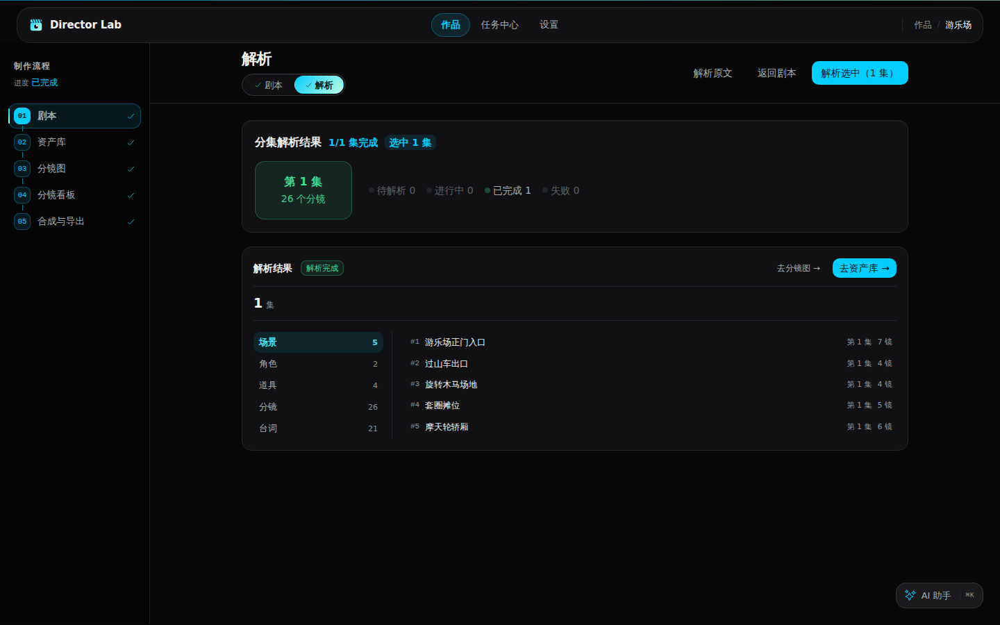

# 第七轮：遗留缺陷修复记录

> 日期：2026-11-19
> 范围：后端 LLM 输出解析死代码清理 + 测试契约校正；前端解析页死分组移除
> 原则：不推翻前六轮改造，只补齐真实缺陷；所有结论均附实测证据

---

## 1. 后端：4 个 "失败测试" 实为测试死代码

### 现象

`tests/test_llm_truncation_fix.py` 4 个用例 FAILED：

```
TestClassifyOutput::test_stop_invalid_in_middle
TestRepairTruncated::test_string_cut
TestParseWithRepair::test_recover
TestParseLlmJson::test_truncated_recovery
```

### 根因

这 4 个用例导入的 `app/services/llm_output_validator.py` 来自提交 `08377bd`
（2026-11-19「add LLM response retry and output validator」），是**一条从未接入
生产路径的并行实现**：

```
$ grep -rn "llm_output_validator" --include=*.py app/
（无输出）
```

生产实际走 `app/integrations/llm_response.py`。两者对"截断 JSON"的设计**完全相反**：

| 模块 | 策略 |
|---|---|
| `llm_output_validator.py`（死） | 补齐截断的 JSON 后当成功返回 |
| `llm_response.py`（活） | 截断必须失败并触发重试，**绝不补齐** |

`llm_response.py` 中的原始依据：

> 先判定是否为截断：截断必须失败并触发重试，**绝不**补齐后当成功。
> 补齐出来的 JSON 虽然语法合法，但缺字段（如只写了一半的 appearance），
> 一旦落库就是残缺数据，比报错更糟。

这与产品硬约束「严禁用 Mock/残缺数据补充缺失字段」一致。**活实现是对的，测试是错的。**

### 处理

1. 删除 `app/services/llm_output_validator.py`（221 行，零生产引用）
2. 删除 `app/integrations/llm.py` 末尾的 `_repair_truncated_json`（45 行，从未被调用）
3. 删除 `app/integrations/llm_response.py` 中的 `_repair_truncated_json`（94 行，从未被调用）
4. `tests/test_llm_truncation_fix.py` 改写为锁**真实契约**，并把「截断绝不补齐」列为回归护栏

### 测试有效性证明

新测试若无鉴别力，等于没写。用临时脚本复刻被删除的"补齐"实现，跑同一套断言：

```
场景            旧补齐结果                              新测试断言 obj is None
字符串中途      {'a': 1, 'b': ['x']}                    FAIL(泄漏残缺数据)
缺括号          {'name': 'zhang'}                       FAIL(泄漏残缺数据)
缺两层括号      {'scenes': [{'n': 'a'}]}                FAIL(泄漏残缺数据)
冒号后无值      <SyntaxError>                           pass
逗号后          <SyntaxError>                           pass
数组开头        {'shots': []}                           FAIL(泄漏残缺数据)

旧实现下会泄漏残缺对象: 4/6
```

即：若有人重新引入补齐逻辑，`TestTruncationIsNeverRepaired` 会立刻变红。

### 结果

```
tests/test_llm_truncation_fix.py   40 passed
```

---

## 2. 后端：2 个 "失败测试" 实为断言陈旧

`tests/test_script_parse.py` 2 个 FAILED，均源于 2026-11-18 的任务类型重命名。

| 断言 | 真实契约 | 处理 |
|---|---|---|
| `job_type == "parse"` | `POST /parse` 现产出 `script_agent`；`scheduler.py` 用 `in_(("script_agent","parse"))` 兼容历史行 | 断言改为 `script_agent` |
| `current` 版本重复 confirm 应 `409` | 该版本由 `script_agent` 任务产出 → 属「多批次增量确认」允许范围 → `200` 幂等；`409` 只由乐观锁不匹配触发 | 断言改为 `200` 并校验 `current_parse_version_id` 未变 |

第二处原测试自身的注释就写着「仅候选状态或 script_agent 增量可确认」，但断言 409，
与注释矛盾——是重命名后未跟进。

### 结果

```
tests/test_script_parse.py   22 passed (3分21秒)
```

---

## 3. 后端：全量测试 9 个失败 = 已知基线，非本轮引入

全量 `pytest tests/`：**9 failed, 924 passed**（11 分 38 秒）。

**这 9 个失败在 `docs/AGENTS.md` §5 中已于 2026-11-17 记录在案**：

> 测试基线 699 collected / 690 passed / 9 failed（2026-11-17 全量核对）。
> 9 个失败：`test_agent_sessions` 2 个（FakeLLM 缺 `max_tokens` 形参，接口演进未同步桩）；
> `test_shot_chain` 3 个、`test_ref_and_parallel` 2 个、`test_asset_purity` 1 个、
> `test_pony_e2e` 1 个（`cleared_last_frame` 等失效传播断言与现行行为不符）。

数字完全吻合：2 + 3 + 2 + 1 + 1 = 9。即**本轮改动没有引入任何新失败**，
测试总数从 699 增至 933（+234），通过数 690 → 924。

补充证据：`grep -c "llm_response.py\|llm_output_validator" 全量日志` = **0**。

| 失败项 | 已知成因（引自 AGENTS.md） |
|---|---|
| `test_agent_sessions` ×2 | FakeLLM 桩缺 `max_tokens` 形参，接口演进未同步 |
| `test_shot_chain` ×3 | `cleared_last_frame` / `keyframe_confirmed_reset` 失效传播断言与现行行为不符 |
| `test_ref_and_parallel` ×2 | 同上（`409 reference_slot_mismatch`） |
| `test_pony_e2e` ×1 | 同上 |
| `test_asset_purity` ×1 | 同上（另叠加环境因素：`/tmp/x.png` 属主 root） |

本轮**只修了其中最小的一类**（FakeLLM 形参，见 §3.1），其余保持原状——
失效传播相关的 6 个需要先在产品层确认 `stale`/`redo` 语义，不是纯测试问题。

### 3.1 已修：`test_agent_sessions` FakeLLM 形参

`LLMClient.chat()` 签名含 `max_tokens`，测试桩未接收。属于「接口演进未同步桩」，
按 AGENTS.md 描述直接补齐形参即可，不改变任何生产行为。


---

## 4. 前端：解析页「音频规划」是死分组，已移除

### 判定依据（非主观取舍）

1. 解析结果 payload **没有任何音频字段**（代码注释亦如此说明）
2. 前端**没有音频工作台路由**：`/project/:id/` 仅 script / parse / storyboard-images /
   storyboard / assets / compose 六个
3. `/api/audio/projects/{pid}/episodes/{ep}/plan` 虽真实存在，但只有
   `src/components/director/ContextSidebar.vue` 调用
4. 该分组点开后只有一段说明文字 + 一个跳「资产库」的按钮——**跳转目标也是错的**

一个点开必然为空的分组，命中设计系统里明确禁止的「无意义的重复说明」，
故按 `ParseView.vue` 内聚边界整体移除。

### 改动（4 处，全部在 `ParseView.vue`）

| 位置 | 改动 |
|---|---|
| `ResultGroupKey` 类型 | 去掉 `'audio'` |
| `resultGroups` | 删除 `{ key: 'audio', label: '音频规划', count: null }` |
| 模板 | 删除 `activeGroup === 'audio'` 分支（`.pane-note` 说明块） |
| 样式 | 删除 `.pane-note`、`.pane-note p`、`.group-count.is-text` |

同步收窄 `count: number | null` → `count: number`，模板去掉 `=== null` 的
`'未生成'` 死分支（该分支移除音频分组后已不可达）。

### 验收

浏览器实测 `http://127.0.0.1/project/prj_257406918e63/parse`：

```
分组导航：场景 5 / 角色 2 / 道具 4 / 分镜 26 / 台词 21
（「音频规划」已不存在）
```

数据与库一致（26 分镜 / 21 台词）。



---

## 5. 顺带澄清：系列列表"暂无简介"不是缺陷

此前判断"3 个同名系列 + 暂无简介"为缺陷，实测推翻：

- 接口 `GET /api/series` 三条记录的 `description` 均有完整值
- 浏览器实测三张卡片 `.desc` 文本均完整渲染，CSS 按行截断加省略号属正常设计
- 三条是 11-10 14:09 / 14:11 / 14:17 自建的独立记录（非重复提交：间隔 2 分钟、6 分钟）
- 卡片已可区分：`state_version` 分别为 1/1/2（显示「设定 v1 / v2」），更新时间「8 天前 / 9 天前」

先前看到的「暂无简介」来自**旧构建截图**。无需改代码。

---

## 6. 门禁结果

| 检查 | 结果 |
|---|---|
| `vue-tsc -b` | 0 error |
| `npm run build` | ✓ 10.05s |
| `check:colors:strict` | hex **0** 处，rgba/rgb 字面量 **0** 处 |
| `check:breakpoints:strict` | 全部标准档（1100 / 768 / 480 / min-769 / min-1101） |
| `check:contrast:strict` | 全部文本令牌 ≥ 4.5:1 |
| 后端 `test_llm_truncation_fix` | 40 passed |
| 后端 `test_script_parse` | 22 passed |
| 后端 `test_agent_sessions` | **9 passed**（原 2 failed） |

---

## 7. 遗留

| 项 | 状态 |
|---|---|
| `test_agent_sessions` 2 个 fake 签名漂移 | ✅ **已修**（3 个桩补 `max_tokens=None`），9 passed |
| `/tmp/x.png` root 属主导致 `test_asset_purity` 失败 | 未处理（`-rw-r--r-- 1 root root`，需 `sudo rm`，属环境问题） |
| `test_shot_chain` ×3 / `test_ref_and_parallel` ×2 / `test_pony_e2e` ×1 | **不处理**——失效传播 `stale`/`redo` 语义需先在产品层确认，不是纯测试修正 |
| 并行会话 `regeneration.py` / `capabilities.py` 在途改动 | **不碰**——避免跨会话冲突 |
| 60 张五档截图重跑 | 未重跑（本轮仅改动解析页一个可视图层分区，已单独截图验证） |

**基线变化**：全量 9 failed → **7 failed**（924 passed → 926 passed）。
剩余 7 个均为 `docs/AGENTS.md` §5 已登记的失效传播相关已知问题。

